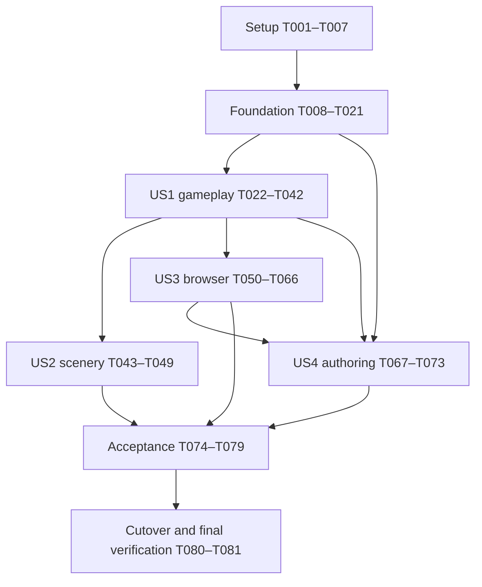

# Tasks: Godot Rewrite with Functional Parity

> **2026-10-13 scope revision:** [Feature 010 plan](../010-upgrade-game-artwork/plan.md) supersedes illustrated-panel production and unchanged-enemy-art assumptions in the tasks below. Reconcile affected scenery/presentation/readiness tasks with 010 before implementation; do not build superseded SVG panels. Engine migration and unaffected parity/delivery work remain prerequisites. This notice does not mark any task complete.

**Branch**: `009-godot-rewrite` | **Generated**: 2026-10-09
**Input**: [spec](spec.md), [plan](plan.md), [research](research.md), [data model](data-model.md), [runtime](contracts/runtime.md), [browser](contracts/browser-platform.md), [delivery](contracts/delivery.md), [authoring](contracts/authoring.md), [quickstart](quickstart.md).

**Tests**: TDD is mandatory. For every automated behavior, write the indicated test,
observe an assertion fail for the expected missing behavior, implement, rerun and
refactor. A missing runner/import is not a behavioral red result. Test groups below
may be developed incrementally with their corresponding implementation; do not write
an entire phase of unexecutable tests before beginning its first slice. Record red/green
commands and results in `specs/009-godot-rewrite/validation/tdd.md`.

**Organization**: Four story phases retain the spec priorities. All tasks start unchecked;
generated documentation does not establish implementation or acceptance. `FR-*` and
`SC-*` mean feature 009 IDs unless explicitly prefixed PRD. `USn.m` means acceptance
scenario m within story n. The spec maps these to PRD 2.5 and features 001–008.

**Paths**: Paths are relative to repository root, including planned new files. Tests
under `tests/platform/` and `tests/tooling/` use Vitest; `tests/godot/` uses GUT;
`tests/e2e/` uses Playwright. Existing suites remain active until mapped replacements
pass. Use Bun, feature branches and conventional commits; all existing automated
suites must pass before a commit. No task authorizes publishing or provisioning hosting.

**Parallelism**: `[P]` identifies independent files within a ready work batch, not
permission to ignore prerequisite phases. See the explicit batches below. No agents
are required by this task list. Manual evidence tasks remain unchecked when unavailable;
record the dependency and continue unaffected implementation.

## Phase 1: Setup

**Goal**: Establish traceability, manual procedures and pinned tools without changing game behavior.

- [ ] T001 Confirm branch and preserve current changes; inventory existing suites and map all 21 feature scenarios, FR-001–015, SC-001–009 and inherited PRD/feature acceptance obligations in `specs/009-godot-rewrite/validation/coverage.md`, distinguishing preserved behavior, missing specified behavior, corrections and pending evidence (FR-001, FR-014).

- [ ] T002 [P] Define build/device/evidence record fields and the phone, concept-before-art, accessibility, soundtrack and five-player procedures from quickstart in `specs/009-godot-rewrite/validation/procedures.md`; retain all PRD SC-001–011 thresholds and explicit pending dependencies before visual implementation (FR-014).

- [ ] T003 [P] Record current legacy unit, browser, typecheck, build/audit and Blender results plus tooling versions in `specs/009-godot-rewrite/validation/baseline.md`; retain the pinned reference commit and report skips/timing failures without treating isolated reruns as a fully green suite (FR-001, FR-014).

- [ ] T004 Add expected-failure tests for editor/template version mismatch, checksum rejection, project-local installation and runner failure propagation in `tests/tooling/godot-setup.test.ts` (FR-013, FR-014).

- [ ] T005 Pin Godot 4.7.2/template origins and checksums in `godot-engine.lock.json`, add `scripts/godot/setup.ts`, and wire setup:godot plus pinned GUT 9.7.1, Workbox/workbox-build 7.4.1 and existing test tools through `package.json` and `bun.lock`; install templates into ignored `.tools/godot/4.7.2/` and keep addon origin/license in `addons/gut/README.vendor.md` (FR-013).

- [ ] T006 Create `project.godot`, `game/app/bootstrap.tscn` and `export_presets.cfg` with Compatibility, single-thread web, no extensions/generated PWA, no input emulation duplication and disabled automatic .blend imports; update `.gitignore` and appropriate `.gdignore` files without excluding runtime GLBs (FR-007, FR-013).

- [ ] T007 Implement GUT/static-check/Blender runner wrappers in `scripts/godot/test.ts`, `scripts/godot/typecheck.ts` and `scripts/test-blender.ts`; surface script/load failures as nonzero exits, prove a deliberately failing assertion is detected, and record runner checks in `specs/009-godot-rewrite/validation/tooling.md` (FR-014).

## Phase 2: Foundational prerequisites

**Goal**: Prove import/export, browser integration and the parity harness before broad porting.
All story implementation depends on the automated foundation checkpoint. Physical phone
smoke is attempted and recorded here; unavailable devices do not block independent work.
A demonstrated platform failure blocks the affected integration until corrected.

### Reference and shared content

- [ ] T008 Write replay schema/comparator tests in `tests/tooling/reference.test.ts` covering ordered events, missing-to-null normalization, frame/viewport/ArenaContext inputs, exact discrete outcomes and continuous tolerance `1e-9 * max(1, abs(expected), abs(actual))`; mismatched hits/targets must fail (FR-001, FR-003, FR-005).

- [ ] T009 Implement `scripts/reference/capture.ts` and `scripts/reference/compare.ts`, capture pinned-reference cases into `tests/reference/manifest.json` and `tests/reference/fixtures/`, and record matched 667x375, 844x390 and 915x412 views in `specs/009-godot-rewrite/validation/reference.md`; include all rule families, camera-dependent targets and stalled/paused frames (FR-001–007).

- [ ] T010 Write shared-catalogue/definition tests in `tests/godot/content/test_catalogue.gd` for unchanged shipped values, distinct roster IDs, resource/clip keys and malformed HP/speed/knockback plus other contract constraints; observe rejection and valid-loading failures before implementing (FR-004, FR-012).

- [ ] T011 Move the four JSON definitions unchanged to `content/characters/`, update `src/content/characters.ts` to the shared location, and extract `content/roster.json`, `content/resources.json`, `content/animation-clips.json`, `content/tuning.json` and `content/levels/neon-velvet.json`; preserve source values, units, order and body envelopes (FR-003–006, FR-012).

- [ ] T012 Implement typed catalogue loading and the authoritative definition validator in `game/content/catalogue.gd` and `game/content/validator.gd`, with immutable validated definitions and actionable field diagnostics; keep resource-independent validation headless and leave imported-resource validation explicit (FR-004, FR-012).

### Testable web foundation

- [ ] T013 [P] Write export/inventory/pack tests in `tests/tooling/export.test.ts` for mode separation, canonical build identity, engine fingerprints, 30 MiB/16 MiB content limits, forced-small-cap splitting, ownership/remaps and load-before-reference order (FR-013, FR-015).

- [ ] T014 [P] Write browser-foundation contract tests in `tests/platform/bridge.test.ts` and `tests/e2e/godot-foundation.spec.ts` for one physical/semantic activation, retained callback, touch cancellation/outside release, gesture audio, pause/explicit resume and complete engine/PCK offline reload (FR-007, FR-010–011).

- [ ] T015 [P] Write import/manual-pose and scene-ownership tests in `tests/godot/presentation/test_import.gd` for one existing rigged fighter, semantic clips, scalar-to-render mapping and released instances; define fixture readiness independently of unproduced final backdrops (FR-007, FR-008).

- [ ] T016 Implement the three build modes and canonical identity/inventory staging in `scripts/godot/export.ts`, `scripts/build-asset-inventory.ts` and `web/runtime-loader.ts`; preload packs before bootstrap mounting, add deterministic category export ownership and forced-cap test fixture, and preserve exported basenames (FR-011, FR-013, FR-015).

- [ ] T017 Implement a minimal versioned browser adapter and Godot bridge in `web/browser.ts`, `game/platform/browser_bridge.gd` and `web/shell.html`, with environment/raw-storage capability boundaries and boot retry; prove one real canvas Control plus semantic activation without JS gameplay logic (FR-007, FR-009–010).

- [ ] T018 Implement exact foundation precaching in `web/sw.ts` and `web/cache-client.ts` for immutable fixture release assets using root `/sw.js`, natural activation and worker-owned inventory digest; prove cold offline engine/pack launch without force activation or circular hashes (FR-011).

- [ ] T019 Implement the reusable import/pose/resource foundation in `game/presentation/character_view.gd` and `game/content/resource_store.gd`; wire a Web Test-only smoke scene at `tests/godot/fixtures/foundation.tscn` with real touch, audio and lifecycle handling, reusing the production boundary classes (FR-007, FR-010).

- [ ] T020 Wire dev, preview, build, build:test, build:diagnostics and focused test commands in `package.json`, `scripts/preview.ts` and `playwright.config.ts`; serve correct MIME types and missing-resource errors and keep Web Test fixtures out of Release/Diagnostics (FR-013–014).

- [ ] T021 Run the automated foundation suite and attempt iPhone 12/Safari and Pixel 6/Chrome smoke procedures; record imported pose, touch, semantics, audio, explicit resume, offline loading, forced pack split and release fixture exclusion in `specs/009-godot-rewrite/validation/foundation.md`, with actual failures or missing devices visible (FR-007, FR-010–015).

**Checkpoint**: Automated foundation passes with runnable reference fixtures and shared
content. Fixture scenery is allowed only for development/test increments; the final
release must require all eight actual backdrop textures.

## Phase 3: US1 — Play the complete game with familiar behavior (P1)

**Goal**: Preserve selection, all combat/roles, progression and the result/retry loop.
**Independent test**: All twelve ordered duos select/count down/play/result/retry;
each fighter completes after partner loss; reference traces retain actions, events,
AI targets, clocks and terminal results. Covers US1.1–6 and SC-001–002.

### Tests first

- [ ] T022 [P] [US1] Add constructor, stable-ID/order, tick-stage, accumulator/backlog, first-frame, countdown and separate active-wall-clock cases in `tests/godot/simulation/test_run_clock.gd`; include pause, long stalls and no five-minute defeat (FR-003, FR-006).

- [ ] T023 [P] [US1] Add movement/facing, single-buffer priority/expiry/cancel, exact move windows, hit-once/depth, damage/protection, meter and dodge cases in `tests/godot/simulation/test_combat.gd` (FR-003; US1.2).

- [ ] T024 [P] [US1] Add all character Special cases in `tests/godot/simulation/test_specials.gd`: area attacks, ROAR normal stun/boss damage, fixed nearest-visible Headrest aim/ties/swept interception/miss/expiry, interruption, no target and spend-once behavior (FR-004; US1.3).

- [ ] T025 [P] [US1] Add grunt/zoner/enforcer/Liam and partner engage/regroup/recover/visibility cases in `tests/godot/simulation/test_ai.gd`, including camera-dependent targets, stable ties and released projectiles surviving stun (FR-005–006).

- [ ] T026 [P] [US1] Add all room waves, boss phases, connectors, tables at (22,-2)/(28,2), single player-only healing drops, full-health consumption, solo continuation and lethal defeat precedence in `tests/godot/simulation/test_progression.gd` (FR-005–006; US1.4–5).

- [ ] T027 [P] [US1] Add selection, generation-safe readiness, countdown, retained-duo retry/home, late results full state-reset and contextual tutorial/legacy-attack-versus-Heavy cases in `tests/godot/app/test_session.gd`; missing visuals block with retry while audio/cache-only failures do not (FR-002, FR-006; US1.1, US1.6, US3.5).

- [ ] T028 [P] [US1] Add physical input tests in `tests/godot/input/test_input_controller.gd` and `tests/e2e/godot-input.spec.ts` for simultaneous movement/action, 60px fixed joystick/15% deadzone, source cancellation, drag threshold, held-key freshness and carried input (FR-002–003, FR-007).

- [ ] T029 [P] [US1] Add camera/pose/HUD and twelve separately parameterized duo journeys in `tests/godot/presentation/test_camera.gd` and `tests/e2e/godot-duos.spec.ts`; use state-based waits and actual canvas interactions, plus deterministic timing assertions in headless tests (FR-002, FR-007; SC-001).

### Models, rules and integration

- [ ] T030 [US1] Implement typed state/events and constructors in `game/simulation/run_state.gd`, `game/simulation/actor.gd` and `game/simulation/events.gd`; implement manual frame accumulator and active/countdown clocks in `game/app/clocks.gd` using scalar float64 values and original ordering (FR-003, FR-006).

- [ ] T031 [US1] Implement action arbitration, movement, contact resolution and resource rules in `game/simulation/actions.gd`, `game/simulation/movement.gd` and `game/simulation/combat.gd`; port source tuning before refactoring and preserve terminal ordering (FR-003).

- [ ] T032 [US1] Implement statuses, area/ROAR/Headrest Specials and both projectile families in `game/simulation/statuses.gd`, `game/simulation/specials.gd` and `game/simulation/projectiles.gd` to pass release/interruption/targeting tests (FR-004).

- [ ] T033 [US1] Implement scalar camera/envelope and legal/visible arena computation in `game/presentation/camera_math.gd` and `game/simulation/arena.gd`; preserve source frame ordering and supply explicit ArenaContext to rules (FR-005, FR-007).

- [ ] T034 [US1] Implement the three enemy roles, Liam phases and partner intent/recovery in `game/simulation/enemy_ai.gd` and `game/simulation/partner_ai.gd`, preserving ordering, role values, knockout and solo behavior (FR-005–006).

- [ ] T035 [US1] Implement encounter progression, tables/pickups, terminal resolution and ordered step orchestration in `game/simulation/encounters.gd`, `game/simulation/objects.gd` and `game/simulation/step.gd`; break after terminal with defeat precedence (FR-006).

- [ ] T036 [US1] Implement session/selection/readiness transitions in `game/app/run_session.gd` and `game/app/selection.gd`, including partial countdown preservation, stale-generation cleanup, safe explicit resume and retained-duo full retry reset (FR-002, FR-006).

- [ ] T037 [US1] Implement Godot-owned touch/mouse/keyboard arbitration in `game/input/input_controller.gd` with source-specific cancel and geometry/lifecycle clearing; keep semantic keyboard intents on the sole bridge route (FR-002–003, FR-007).

- [ ] T038 [US1] Implement selection previews/stats, Godot HUD/combat controls, countdown, pause/settings and result/home/retry screens in `game/ui/selection_screen.gd`, `game/ui/combat_hud.gd` and `game/ui/session_screen.gd`; emit semantic descriptors for platform integration and keep settings usable while paused (FR-002, FR-006–007).

- [ ] T039 [US1] Integrate the complete world, camera, ally/enemy views, manual animations, shadows/telegraphs/effects and resource ownership in `game/presentation/world_view.gd` and `game/app/main.gd`; preserve ally scale 1.25, facing/pose and muted/no-shake feedback (FR-007).

- [ ] T040 [US1] Port contextual tutorial state and prompts in `game/ui/tutorial.gd`, preserving Heavy as separate from legacy attack completion; connect the shared persistence service when US3 lands (FR-006, FR-009).

- [ ] T041 [US1] Implement canonical Godot replay and Web Test-only snapshots/fixtures/control bounds in `tests/godot/replay_runner.gd` and `game/platform/test_bridge.gd`; wire test:parity in `package.json`, and physically exclude test registration/resources from release (FR-001, FR-014).

- [ ] T042 [US1] Run all US1 suites/replays and matched visual checks, record all twelve duos/four solo outcomes and intentional spec corrections in `specs/009-godot-rewrite/validation/us1.md`, and update coverage without claiming unresolved browser/art/device acceptance (FR-001–007; SC-001–002).

**Checkpoint**: Complete playable parity increment. Final scenery, browser reliability,
physical acceptance and authoring are still required for the full product.

## Phase 4: US2 — Recognize the complete nightclub journey (P1)

**Goal**: Deliver all four specified settings while preserving geometry, readability and accessibility.
**Independent test**: Load each room and transition with representative busy encounters;
verify unchanged collision/waves/tables, correct GO, no gaps and recognizable cues.
Concept approval precedes final art; final recognition uses five players (US2.1–5, SC-006).

### Tests and concepts before final art

- [ ] T043 [P] [US2] Add backdrop catalogue/SVG/import/budget tests in `tests/tooling/backdrops.test.ts` and `tests/godot/presentation/test_backdrops.gd`: exact four stable-ID mappings, eight image sizes, self-contained static SVGs, required preload and <=64 MiB decoded textures including mipmaps (FR-008, FR-015).

- [ ] T044 [P] [US2] Add transition/layout/GO regression cases in `tests/e2e/godot-backdrops.spec.ts` for camera margins/connectors, 90% view coverage, safe controls, reduced motion, no new interactions and no GO after terminal/reset (FR-007–008; US2.2–4).

- [ ] T045 [US2] Create four camera/HUD/character-composited concepts in `specs/009-godot-rewrite/reviews/backdrop-concepts.md` with referenced concept assets under `assets/backdrops/concepts/`; record actual reviewer decisions on feature 008 cues before producing final panels, leaving unresolved decisions pending (FR-008; US2.5).

### Art and scene integration

- [ ] T046 [US2] After concept review, produce wall.svg (2048x1024) and floor.svg (1024x512) in each of `assets/backdrops/outside-entrance/`, `assets/backdrops/bar/`, `assets/backdrops/dance-floor/` and `assets/backdrops/stage-vip/`; preserve quiet floors, branding, rightward entrance and editable self-contained vector source (FR-008).

- [ ] T047 [US2] Implement `content/backdrops.json` and `game/presentation/backdrops.gd` with static opaque unlit panels, three connector/backing surfaces and camera margins; retain all visible room groups and unchanged gameplay collections (FR-008).

- [ ] T048 [US2] Integrate actual all-eight-texture readiness and required-resource errors in `game/content/resource_store.gd`, and correct GO/layout/reduced-motion behavior in `game/ui/combat_hud.gd` only where tests identify differences; remove development scenery from production paths (FR-007–008).

- [ ] T049 [US2] Run US2 tests and record four in-game reviews with busy scenes, all character silhouettes, telegraphs, controls, edges and transitions in `specs/009-godot-rewrite/reviews/backdrops-final.md`; retain actual approval/pending decisions and defer participant recognition to the final player evaluation (FR-008; US2.1–5).

## Phase 5: US3 — Continue using the mobile browser game reliably (P1)

**Goal**: Preserve saved records and accessible interaction through audio, lifecycle,
loading, offline use and upgrades on supported phones.
**Independent test**: Upgrade the legacy release on the same origin, interrupt every
locked phase, then complete cached offline runs/results/retries and multi-window update
scenarios. Run on both phones in browser and installed modes where supported
(US3.1–7, SC-003–005, SC-009).

### Tests first

- [ ] T050 [P] [US3] Add storage compatibility/default/denial tests in `tests/godot/platform/test_persistence.gd` and `tests/platform/storage.test.ts` for the three exact keys/schemas, field fallback, strict better-victory replacement, canonical tutorial IDs and no transient saves (FR-009; US3.1–2).

- [ ] T051 [P] [US3] Add semantic projection tests in `tests/platform/semantics.test.ts` and `tests/e2e/godot-accessibility.spec.ts` for native roles/labels/ranges, focus without preview, roving twelve-entry fixture roster, modal restore/trap, stale generations, exactly-once intents and safe CSS bounds (FR-007, FR-010).

- [ ] T052 [P] [US3] Add lifecycle/audio tests in `tests/godot/platform/test_lifecycle_audio.gd` and `tests/e2e/godot-lifecycle.spec.ts` for hide/blur/portrait at every countdown numeral and during Specials, frozen effects/clocks, explicit resume, one streamed track/eight effect voices and silent fallback (FR-010; US3.2–3).

- [ ] T053 [P] [US3] Add loading/context/resource-cycle cases in `tests/e2e/godot-loading.spec.ts` and `tests/godot/content/test_resource_store.gd`: missing models/clips/scenery, late success/error, retained duo retry, cache-only failure, recoverable context loss versus reload and ten-cycle stable ownership (FR-010–011, FR-013).

- [ ] T054 [P] [US3] Add worker protocol/repair tests in `tests/platform/cache.test.ts` for digest/length corruption, revision-aware keys, missing files, wrong versions/IDs, quota denial, serialized repair, request generations and 10s idle/120s total deadlines (FR-011).

- [ ] T055 [P] [US3] Add legacy/new-release two-window install/update/offline tests in `tests/e2e/godot-offline.spec.ts` with immutable fixtures under `tests/reference/releases/`; cover preparing/countdown/running/paused sessions, no forced takeover, complete roster/audio/room availability and old saved data (FR-009, FR-011; US3.4–6).

- [ ] T056 [P] [US3] Add full release audit and diagnostics isolation tests in `tests/tooling/release-audit.test.ts` and `tests/e2e/godot-release.spec.ts`, including engine exceptions, duplicate content, compressed/cached totals, missing resources, test-hook leakage and final evidence requirements (FR-013–015).

### Browser services and complete release

- [ ] T057 [US3] Implement persistence validation/in-memory fallback and editor-only adapter in `game/platform/persistence.gd` and `game/platform/editor_platform.gd`; extend `web/browser.ts` with allowlisted raw storage, then connect settings/tutorial/best-result ownership to session and UI (FR-009).

- [ ] T058 [US3] Implement native semantic mirroring in `web/semantics.ts` and Godot descriptor/focus decisions in `game/ui/semantics.gd`; retain DOM identity, live-region discipline, safe text insertion, pointer transparency and one keyboard/assistive route (FR-007, FR-010).

- [ ] T059 [US3] Complete environment/safe-inset/reduced-motion/lifecycle bridge in `web/browser.ts` and `game/platform/lifecycle.gd`; integrate explicit resume, fresh inputs and context restoration/reload into `game/app/run_session.gd` and `web/shell.html` (FR-010).

- [ ] T060 [US3] Implement one streamed music player and eight reusable sample effect voices in `game/platform/audio.gd`, connect real selection/Retry/Resume gestures synchronously including semantic callbacks, preserve pause position and restart on Retry with independent levels and silent fallback (FR-010).

- [ ] T061 [US3] Complete generation-safe resource preparation/coalescing and teardown in `game/content/resource_store.gd` and `game/presentation/world_view.gd`; require chosen visuals/all backdrops/first view before countdown and prove ten-cycle stable ownership (FR-010–011, FR-013).

- [ ] T062 [US3] Complete worker digest/length verification, exact repair, timeout/progress, legacy CACHE_STATUS compatibility and app-owned cache cleanup in `web/sw.ts` and `web/cache-client.ts`; never claim readiness from a stored flag or clean old caches during install (FR-011).

- [ ] T063 [US3] Integrate separate runtime/offline readiness, actionable Retry and between-run close-all-windows update notices in `game/ui/readiness.gd` and `game/platform/browser_bridge.gd`; preserve nonblocking cache failure and no auto-reload (FR-011).

- [ ] T064 [US3] Complete `scripts/audit-build.ts` and export membership checks, covering official engine fingerprints, every pack/resource/remap, 30 MiB content/16 MiB files, duplicate bytes, inventory/worker totals and deterministic gzip/Brotli estimates; add --final evidence validation (FR-013–015).

- [ ] T065 [US3] Implement read-only frame/resource/render diagnostics in `game/platform/diagnostics.gd` and `web/diagnostics.ts`, restricted to Web Diagnostics; capture active frame intervals/rolling FPS/draw calls/triangles/owned counts with local JSON download and no telemetry (FR-013–014).

- [ ] T066 [US3] Run US3 browser/unit/release checks and actual phone storage/audio/lifecycle/VoiceOver/TalkBack/offline/installed/update procedures; record build/device versions, full-level outcomes, limitations and pending evidence in `specs/009-godot-rewrite/validation/us3.md` (FR-007, FR-009–015; SC-003–005, SC-009).

## Phase 6: US4 — Continue creating and maintaining characters (P2)

**Goal**: Preserve existing character tooling and editable assets with one validation authority.
**Independent test**: Validate all four definitions/resources, exercise Lion and Plates
through the Godot workflow, and verify actionable rejection cases plus unchanged
unrelated fingerprints. Two actual review records are required (US4.1–3, SC-008).

### Tests first

- [ ] T067 [P] [US4] Add CLI/validator contract cases in `tests/tooling/character-cli.test.ts`: full/per-character/--root validation, imported missing clips, diagnostic/exit propagation, malformed definitions and unsupported mechanics; normal validation cannot skip assets (FR-012; US4.1–2).

- [ ] T068 [P] [US4] Add scaffold preservation cases in `tests/tooling/character-scaffold.test.ts`: invalid brief, duplicate ID, existing output, incomplete draft, explicit --output-dir, active-feature default and unchanged unrelated fingerprints; preserve definition/report fields (FR-012; US4.2).

### Tooling and workflow

- [ ] T069 [US4] Implement headless authoritative validation in `game/tools/validate_content.gd` and imported model/clip/prop checks in `game/content/validator.gd`; turn `scripts/characters/validate.ts` into a thin Bun adapter preserving existing CLI options (FR-012).

- [ ] T070 [US4] Update `scripts/characters/scaffold.ts` for explicit output scope and active SpecKit feature defaults; reject conflicts before mutation and retain incomplete nonregistered drafts with actionable reports (FR-012).

- [ ] T071 [US4] Apply the skill-creator workflow to update `.agents/skills/character-builder/SKILL.md` and `.agents/skills/character-builder/references/workflow.md` with Godot import/validation/playable review commands; preserve scoped Blender options and document consistency validation (FR-012).

- [ ] T072 [US4] Run Blender and source/import validation, then actual Lion and Plates workflow/playable exercises; record commands, fingerprints, outputs and visual/gameplay/device review status in `specs/009-godot-rewrite/reviews/lion-godot.md` and `specs/009-godot-rewrite/reviews/plates-godot.md` without regenerating unrelated assets or relabeling historical reports (FR-012; SC-008).

- [ ] T073 [US4] Verify four-character integration and complete offline roster after the tooling changes, rerun rejection/preservation tests and reconcile US4.1–3 evidence in `specs/009-godot-rewrite/validation/us4.md`; keep unresolved playable reviews pending (FR-004, FR-011–012).

## Phase 7: Cross-cutting validation and cutover

**Goal**: Complete acceptance with actual evidence, then retire the superseded runtime.
These are required delivery gates, not optional polish. No historical result substitutes
for the release being evaluated; corrections require red–green regression tests.

- [ ] T074 Wire the full test:unit/test:platform/test:parity/test:e2e/test:blender/test/typecheck/build/audit command set in `package.json`, retaining still-active legacy suites; run every quickstart command and update `specs/009-godot-rewrite/quickstart.md` to verified executable usage (FR-014).

- [ ] T075 Confirm the intended owner soundtrack, bundle it at the configured `public/assets/audio/` path and record actual identity/licensing/review confirmation in `specs/009-godot-rewrite/validation/soundtrack.md`; rerun audio/import/cache/size checks, leaving final acceptance pending if the track is unavailable (FR-010–011, FR-014–015).

- [ ] T076 Measure complete intended-content runs and ten lifecycle cycles on iPhone 12/Safari and Pixel 6/Chrome; record raw frame intervals, active-only rolling FPS, busiest encounters, stalls, draw/triangle/DPR/texture budgets and release cross-checks in `specs/009-godot-rewrite/validation/performance.md` (FR-013; SC-005).

- [ ] T077 Conduct five-first-time-player evaluation and record individual outcomes and per-criterion thresholds in `specs/009-godot-rewrite/validation/playtest.md`: all PRD SC-001–011, separate responsiveness/readability, first-success duration/attempts, action learning, role/exit understanding, Lion/Plates distinction and four unlabelled settings (FR-014; SC-006–007).

- [ ] T078 Reconcile complete phone touch/accessibility/lifecycle/audio/offline/update evidence, all four art reviews and both character reports in `specs/009-godot-rewrite/validation/coverage.md`; fix observed defects with failing regression cases before correction, revalidate affected procedures and leave unavailable evidence unresolved (FR-001, FR-014).

- [ ] T079 Produce complete release audit evidence and static-host/rollback instructions in `specs/009-godot-rewrite/validation/release.md`, preserving manifest identity, legacy URLs and previous immutable release artifacts; record compressed estimates versus measured transfers and cached payload without provisioning/publishing (FR-011, FR-013–015; SC-009).

- [ ] T080 After replacement coverage, parity and required acceptance evidence pass, retire superseded JS runtime under `src/` and only its mapped tests, remove obsolete Three/gameplay dependencies while retaining Vite if required by Vitest from `package.json` and `bun.lock`, retain Bun/browser tools and immutable reference fixtures, and record the deletion/replacement manifest in `specs/009-godot-rewrite/validation/cutover.md` (FR-001, FR-014).

- [ ] T081 Update `README.md` and `specs/009-godot-rewrite/validation/acceptance.md` with Godot development, static hosting and actual acceptance status; rerun every automated suite, typecheck, build, release smoke and audit --final after cutover, recording results and any blockers before any conventional commit or completion claim (FR-001, FR-014–015; SC-001–009).

## Dependencies and execution order

### Phase graph

The graph shows **completion dependencies**. US4 definition/scaffold tests and wrappers
can start after foundation; its playable and offline exercise needs US1/US3. US2 and
US3 can start after US1, but complete-offline US3 acceptance needs US2's final content.
This is an integration dependency, not a reason to defer browser work until art reviews
are available. Perform US3 platform work while a concept decision is pending.

| Ready work / gate | Prerequisites |
| --- | --- |
| T002–T003 independent setup batch | T001; separate evidence files. |
| T005–T007 tool/project setup | T004 red cases; runner verification before foundation tests. |
| T009 reference capture | T008 comparator red cases, pinned source/content identity; preserve legacy runtime. |
| T011–T012 catalogue | T010 red fixtures; do not copy two editable catalogues. |
| T013–T015 independent foundation tests | T007 and T012; each owns separate tests. |
| T016–T020 foundation implementations | Corresponding T013–T015 failures; T016 pack loader before T018 offline proof; T017 bridge before T019 smoke integration. |
| T021 foundation checkpoint | T008–T020 automated checks pass; record actual phone smoke or missing-device dependency. |
| T022–T029 independent US1 test batch | Automated foundation; use test-only stubs/fixtures to isolate the new behavior where needed. |
| T030–T041 US1 implementation | Matching red tests below; state before rules, rules before orchestration, camera before targeting integration, session before screens. |
| T042 US1 checkpoint | All US1 implementations/replays/browser journeys; no unsupported claim of final scenery/platform acceptance. |
| T043–T044 independent US2 test batch | US1 world/session interfaces; separate test files. |
| T046 final panels | T045 actual concept review, plus T043 validation rules; pending approval keeps this task open. |
| T047–T049 scenery integration/review | Final panels and T044 regression cases; coordinate T048/T061 shared ResourceStore edits. |
| T050–T056 independent US3 test batch | US1 interfaces and foundation exports; controlled release fixtures allow tests before final art. |
| T057–T065 platform implementation | Matching red tests; T057 persistence before saved UI integration, T058/T059 before semantic audio checks, T062 worker before T063 readiness. |
| T066 US3 checkpoint | US3 implementations, US2 actual textures for full cached acceptance, actual phones where required. |
| T067–T068 independent US4 test batch | Foundation catalogue/validator and stable CLI contract. |
| T069–T071 workflow implementation | T067–T068 red cases; skill documentation gets consistency review; coordinate catalogue edits. |
| T072–T073 workflow checkpoint | US1 playable roles, US3 offline roster, updated tools and actual review records. |
| T074 command verification | Implemented command owners; keep all active suites included. |
| T075–T079 final acceptance | All implemented stories; intended soundtrack before performance/player/offline final results; collect evidence only for the evaluated content/build. |
| T080 reference retirement | Coverage/replacements, automated parity and required acceptance evidence pass; previous deployable release preserved. |
| T081 final verification | Cutover changes complete; all suites and final export/audit rerun. |

Default execution is phase/ID order. Test and implementation tasks form red–green slices;
a phase's implementation can start when its own test failure is established, without
waiting for every unrelated test file to be written. Do not commit intermediate failing
suites. Shared `package.json`, ResourceStore, bridge and session edits are serialized.

### Test-to-implementation pairs

| Red tests | Implementation / green verification |
| --- | --- |
| T004 | T005–T007 tool setup and failure propagation. |
| T008 | T009 capture/comparison; T041 Godot replay; T042 parity verification. |
| T010 | T011–T012 content extraction/validation. |
| T013 | T016 export/packs, T020 preview/build wiring; T021 actual cold pack checks. |
| T014 | T017–T019 browser/worker/smoke; T020 browser runner; T021 proof. |
| T015 | T019 import/pose/ownership; T021 proof. |
| T022 | T030 state/clocks; T035 ordered step; T036 countdown. |
| T023 | T031 actions/movement/contact; T035 orchestration. |
| T024 | T032 Special/status/projectile rules. |
| T025 | T033 camera/arena; T034 enemy/partner AI. |
| T026 | T035 objects/encounters/terminal and T042 solo outcomes. |
| T027 | T036 session; T040 tutorial; T042 reset journeys. |
| T028 | T037 physical input; T038 controls. |
| T029 | T033 camera, T038–T039 UI/world and T041 test bridge. |
| T043–T044 | T046–T048 art/catalogue/scene/GO; T049 review. |
| T050 | T057 persistence. |
| T051 | T058 semantics. |
| T052 | T059 lifecycle and T060 audio. |
| T053 | T059 context recovery and T061 resource lifecycle. |
| T054–T055 | T062–T063 worker/cache/readiness; T066 complete upgrade/offline checks. |
| T056 | T064 audit and T065 diagnostics; T066 release smoke. |
| T067 | T069 CLI/import validation. |
| T068 | T070 scoped scaffold. |

Pure static setup and documentation use configuration/import/consistency validation.
Any testable logic introduced by wrappers or tooling follows the associated red tests;
add focused cases before implementation where those listed need expansion.

## Parallel examples per story

These are scheduling examples after prerequisites pass; they do not request automatic
agent delegation. Independent test-authoring batches contain **24 marked tasks** total:
setup T002–T003 (2), foundation T013–T015 (3), US1 T022–T029 (8),
US2 T043–T044 (2), US3 T050–T056 (7), US4 T067–T068 (2).

- **US1:** T023 combat tests in `tests/godot/simulation/test_combat.gd` alongside
  T024 Specials in `tests/godot/simulation/test_specials.gd` and T027 session tests
  in `tests/godot/app/test_session.gd`. Merge test support changes serially.
- **US2:** T043 SVG/import tests in `tests/tooling/backdrops.test.ts` and
  `tests/godot/presentation/test_backdrops.gd` alongside T044 camera/GO journeys
  in `tests/e2e/godot-backdrops.spec.ts`. Final art waits for concept decisions.
- **US3:** T050 persistence tests in `tests/godot/platform/test_persistence.gd`
  alongside T054 cache protocol tests in `tests/platform/cache.test.ts` and T056
  audit tests in `tests/tooling/release-audit.test.ts`. Do not concurrently edit the worker.
- **US4:** T067 CLI tests in `tests/tooling/character-cli.test.ts` alongside
  T068 scaffold preservation tests in `tests/tooling/character-scaffold.test.ts`.
  Share temporary-fixture utilities only after agreeing and merging their interface.

## Requirement and acceptance coverage

| Feature requirements | Task coverage | Independent acceptance |
| --- | --- | --- |
| FR-001, FR-014 | T001–T003, T008–T009, T041–T042, T074–T081 | All 21 scenarios, all inherited obligations, SC-002/SC-007 and honest evidence. |
| FR-002 | T027–T029, T036–T038, T042 | US1.1/1.6, US3.3/3.5; twelve duos, readiness/countdown, SC-001. |
| FR-003 | T022–T023, T028, T030–T031, T035, T037, T041–T042 | US1.2–3; exact combat/input outcomes, SC-002. |
| FR-004 | T010–T012, T024, T032, T042, T073 | US1.1–4; four abilities and role-correct behavior, SC-001–002. |
| FR-005 | T025–T026, T033–T035, T042 | US1.2/1.4; camera-dependent partner/solo parity, SC-001–002. |
| FR-006 | T022, T026–T027, T030, T035–T036, T040, T042 | US1.4–6; encounters/results/clock/tutorial/reset, SC-001–002. |
| FR-007 | T014–T015, T019, T028–T029, T033, T037–T039, T044, T048–T049, T051, T058, T066, T076–T077 | US1.1, US2.2–4; close presentation, accessible controls, SC-005/SC-007. |
| FR-008 | T043–T049, T077 | US2.1–5; four concepts and final rooms, SC-006. |
| FR-009 | T050, T055, T057, T066 | US3.1–2; retained data and fallback, SC-003. |
| FR-010 | T014, T017, T019, T052–T053, T058–T061, T066, T075 | US3.2–3; audio/interruption/explicit resume, SC-004. |
| FR-011 | T013–T014, T016, T018, T053–T055, T061–T063, T066, T073, T079 | US3.4–6; loading/offline/install/update, SC-004. |
| FR-012 | T010–T012, T067–T073 | US4.1–3; four valid characters and two actual workflow records, SC-008. |
| FR-013 | T004–T007, T013, T016, T020–T021, T053, T056, T061, T064–T066, T076, T079 | US3.4/3.7; static delivery and phone performance, SC-004–005. |
| FR-015 | T013, T016, T043, T056, T064, T075–T076, T079, T081 | Complete content/engine size review, SC-009. |

Coverage T001 expands the inherited PRD requirements and acceptance IDs rather than
assuming these task ranges prove every edge case. T078 resolves omissions before acceptance.

## Implementation strategy

The first demonstrable **MVP increment** is Setup + Foundation + US1: the full gameplay
loop with all twelve duos, deterministic parity and result/retry. It is not acceptance
of the project's complete MVP and does not defer US2, US3 or US4. Demonstrate locally;
publication is outside this scope.

Proceed with US2/US3 after the playable increment, allowing browser work during concept
review. Build US4 tools on the shared validator and complete their playable/offline
exercises after the relevant integrations. Collect intended-track, phone and player
inputs early to avoid leaving evidence until the final day. Missing physical devices
or review decisions leave their acceptance tasks unchecked; continue independent work.

Keep the previous runtime and tests until T080's cutover gate. All subsequent fixes
must reproduce automatable defects before correcting them. Do not loosen timing,
resource limits or acceptance thresholds to make tests pass. If player criteria expose
a required tuning correction, document its current-spec basis and update affected
fixtures/evidence; migration alone does not authorize rebalancing.

Complete T081 only when actual automated and physical evidence satisfies all criteria.
No account/backend, native packaging, extra characters, hosting publication or CI pipeline
is introduced. Current generation is documentation-only; validate this task list and
its links/IDs/coverage without claiming any runtime tasks have been executed.
