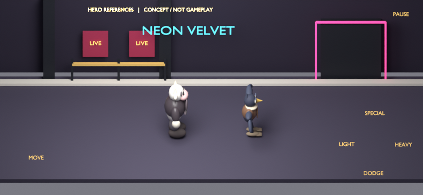
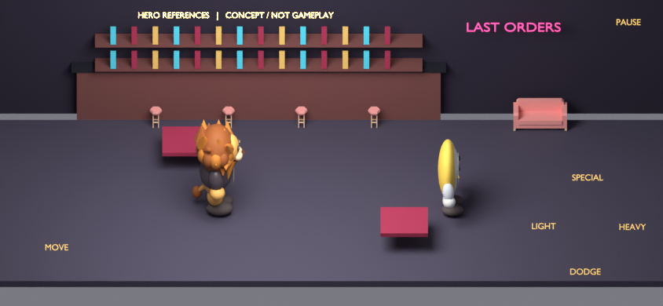
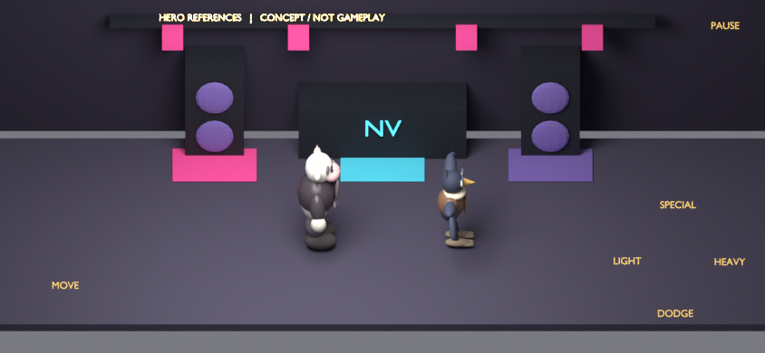
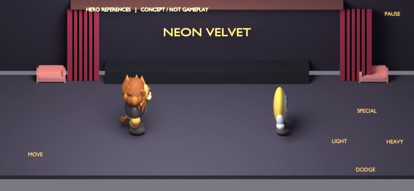
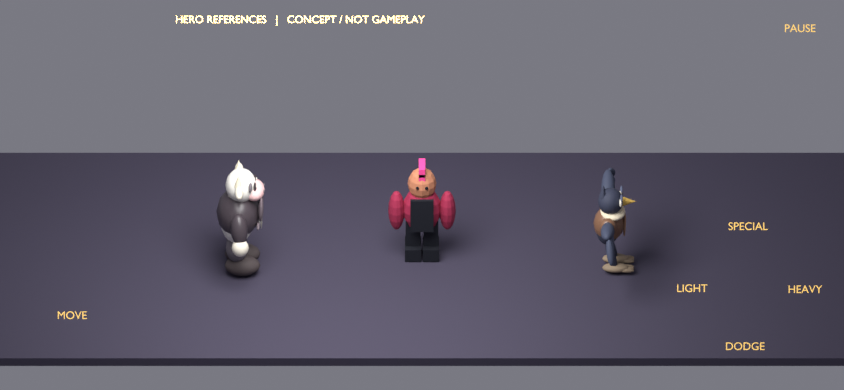
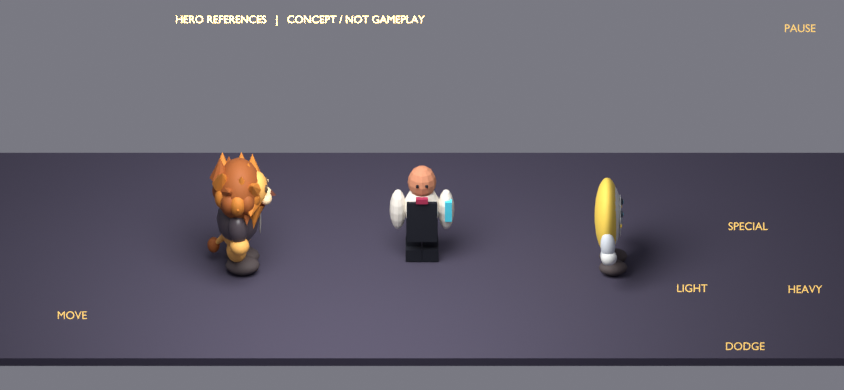
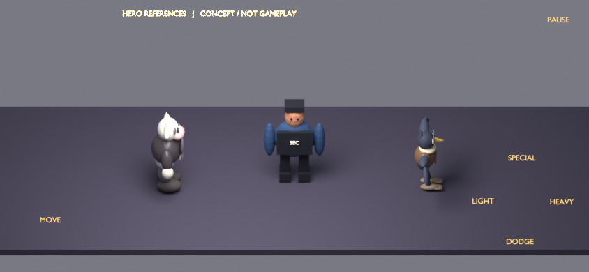
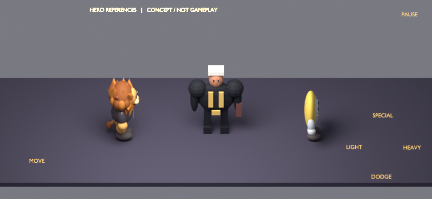

# Eight concept blockouts — T006 (direction approved)

Created 2026-10-14 from editable 3D geometry with imported existing hero references. These PNGs are Blender concept renders, not screenshots of implemented scenery/enemies. The camera derives from the baseline 844x390 projection; HUD labels mark inherited control locations. Actual phone/HUD/camera integration remains unverified. The owner approved the appearance direction ("I like the images") and then instructed proceeding with KayKit reuse. Final gameplay production/review is separate.

Editable [eight-scene Blender file](concepts/concepts.blend), [source script](source/create_concepts.py), [hash-bound records](concepts/records.json) and [manual procedures](../validation/procedures.md). Images show all four hero references across the eight subjects. Kenney stools/sofas/counter parts are included in room drafts; enemy drafts explore original rounded silhouettes while Quaternius remains a rig candidate.

| Subject | Owner outcome | Technical findings / remaining work |
| --- | --- | --- |
| [exterior](concepts/exterior.png) | Direction approved | Frontage/sign/door/pavement/queue/posters have 3D blockout locations. Light spill and scruffy surface dressing still need refinement; doorway route alignment needs actual venue integration. |
| [bar](concepts/bar.png) | Direction approved | Continuous counter/shelves/stools and reused sofa read as a bar arrangement; sofa is only a booth-seat candidate. Warm lighting/booth enclosure and interactive-table visual distinction need final review. |
| [dance-floor](concepts/dance-floor.png) | Direction approved | Booth/speaker/truss/fixtures/static coloured pools shown; final lighting/materials and all connector/camera-edge coverage still need runtime validation. |
| [stage-vip](concepts/stage-vip.png) | Direction approved | Curtain folds/backdrop/branding/stage and reused side sofas shown. Dramatic lighting and material finish pending; decorative stage is not walkable. |
| [grunt](concepts/grunt.png) | Direction approved | Mohawk and vest suggest a small mobile patron. Rounded blockout only; compare/adapt the free Punk rig before final choice. All required animation states are missing. |
| [zoner](concepts/zoner.png) | Direction approved | Apron/bow tie/bottle suggest staff; body needs final silhouette/hand work. Compare/adapt free Suit rig. All states and projectile-release alignment are missing. |
| [enforcer](concepts/enforcer.png) | Direction approved | Wide vest/crew cut suggest security. Avoid relying on small SEC text for recognition; final outfit/rig/charge coverage is missing. |
| [liam](concepts/liam.png) | Direction approved | Oversized shoulders/coat lapels/light hair/rope differ geometrically from Enforcer. White block hair needs shaping; phase-two styling and every action/state are missing. |

## Room concepts

### exterior



### bar



### dance-floor



### stage-vip



## Enemy concepts

### grunt



### zoner



### enforcer



### liam



## Review and reproduction

The owner has approved all eight appearance directions; the records retain the technical refinements identified during preparation. These concept files remain unrigged blockouts. Subsequent Grunt/Zoner motion work is tracked separately in [the KayKit pilot](kaykit-pilot.md). Owner concept approval does not certify completed animation or final gameplay art. Final phone, player and eight final-subject reviews remain separate.

```sh
XDG_CACHE_HOME="$PWD/.tmp/blender-concept-cache" blender -noaudio --background --factory-startup --python-exit-code 1 --python specs/010-upgrade-game-artwork/reviews/source/create_concepts.py
```

Re-rendering updates image/Blender hashes and invalidates the affected appearance record; refresh `records.json` before review. The source inputs and concepts are excluded from runtime exports. See validation/evidence/concept-render.txt for actual rendering results; a PulseAudio wakeup warning did not prevent all eight PNGs and the editable source from being saved.

## Owner direction decision — 2026-10-14

Owner: “I like the images”, followed by “brilliant, proceed” after the KayKit assessment. All eight concept directions are approved for production, preserving recorded technical refinements. This is not final rig/animation, mobile or in-game acceptance.
