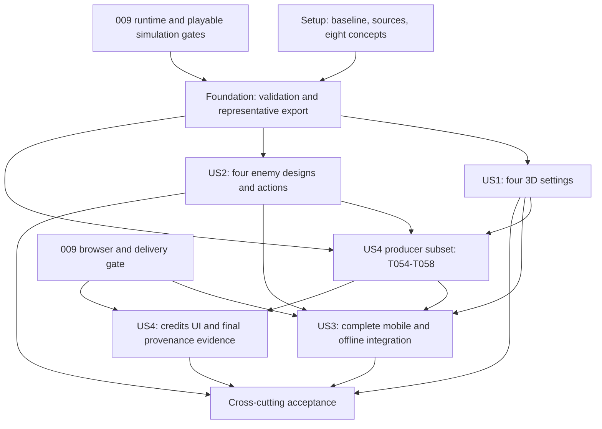

# Tasks: 3D Venue Scenery and Enemy Characters

**Branch**: `010-upgrade-game-artwork` | **Generated**: 2026-10-13
**Input**: [spec](spec.md), [plan](plan.md), [research](research.md), [data model](data-model.md), [art content](contracts/art-content.md), [presentation](contracts/presentation.md), [validation/delivery](contracts/validation-delivery.md), [quickstart](quickstart.md).

**Tests**: TDD is mandatory under AGENTS.md and the constitution. For each automatable increment, write its behavioral test, observe the intended assertion failure, implement the smallest passing change and refactor. Test groups can be developed incrementally with their paired implementation; setup/import failures are not red-phase evidence. Record commands/results in `specs/010-upgrade-game-artwork/validation/tdd.md`. Manual procedures precede visual production. Document tasks receive consistency checks.

**Organization**: Four story phases retain the specification's P1/P1/P1/P2 order. All tasks start unchecked. FR/SC identifiers refer to feature 010 unless prefixed PRD; USn.m identifies a specification acceptance scenario. Paths are repository-relative, including proposed new files. No endpoint/backend work is needed.

**Execution**: Stay on the feature branch, preserve unrelated files, use Bun and conventional commits, and pass all existing automated tests before any commit. Generated plans, untracked builds and missing test suites never count as implementation evidence. This list does not authorize deployment. `[P]` marks disjoint tasks in a ready batch; complete the listed prerequisites first. No agent delegation is required.

## Phase 1: Setup

**Goal**: Establish current evidence, scope, asset candidates and concept decisions. These tasks can proceed while the missing Godot foundation is completed elsewhere. Concepts/provenance serve all stories and therefore live in shared setup.

- [X] T001 Confirm branch and record all 17 acceptance scenarios, FR-001–013, SC-001–007 and inherited PRD obligations in `specs/010-upgrade-game-artwork/validation/coverage.md`; identify existing tests/replacement ownership and keep implementation, art, device and participant status separate (FR-001–013).
- [X] T002 [P] Define the eight concept/eight final subject reviews, action/landmark checks, phone/offline/performance procedures and five-player measures from quickstart in `specs/010-upgrade-game-artwork/validation/procedures.md`, including source/build hashes, actual outcomes and pending-evidence rules before visual production (FR-007–013).
- [X] T003 [P] Run existing baseline commands from quickstart, record tool versions and actual suite/build results, and capture equivalent room/action/layout views with source/build IDs in `specs/010-upgrade-game-artwork/validation/baseline.md`; preserve hero source/runtime fingerprints and record failures/skips accurately (FR-003, FR-006, FR-010).
- [X] T004 Audit actual source against the external prerequisite table below and record exact feature 009 task dependencies, source commits, commands and missing capabilities in `specs/010-upgrade-game-artwork/validation/prerequisites.md`; reconcile superseded SVG tasks without marking them implemented and do not use `.godot/` or `dist-*` as proof (FR-003, FR-009–010).
- [X] T005 Inspect the shortlisted free archives from `specs/010-upgrade-game-artwork/asset-candidates.md`, retain source/version/date/hash/license evidence in `assets/art-sources/`, and seed `content/art-provenance.json` with actual selected-file/clip inventories, suitability decisions and original-art fallbacks; verify modification/distribution conditions before accepting any candidate (FR-011–012; US4.1–2).
- [X] T006 After T002 and T005, produce four room and four enemy concepts beside existing heroes/camera/HUD and record actual owner review outcomes in `specs/010-upgrade-game-artwork/reviews/concepts.md`; identify every required landmark, distinct role/boss silhouette and missing action, leaving unresolved subjects pending before their final production (FR-002, FR-004, FR-013; US4.3).

## Phase 2: Foundational prerequisites

**Goal**: Establish the actual Godot integration boundary, shared validation and a representative export proof before story implementation. T007 is a source/runtime prerequisite; unavailable phone evidence is separately tracked and cannot be called passing. Source preparation in Phase 1 remains available while this gate is unresolved.

### Runtime gate and tests first

- [ ] T007 Satisfy the runtime gate using the mapped feature 009 tasks: verify checked-in `project.godot`, `export_presets.cfg`, `game/app/run_session.gd`, `game/presentation/world_view.gd`, `game/content/resource_store.gd`, working simulation/camera snapshots, GUT and actual web exports; complete/integrate missing 009 work through its own TDD tasks before checking this gate in `specs/010-upgrade-game-artwork/validation/prerequisites.md` (FR-003, FR-006, FR-009).
- [x] T008 [P] Write and observe failing structural contract cases in `tests/godot/art/test_art_catalog.gd` for schema versions, exact room/role coverage, stable IDs, finite transforms, dependency/source references, path safety, semantic bindings and invalid segments; use valid/minimal isolated fixtures without claiming final art (FR-001, FR-004–005, FR-012).
- [ ] T009 [P] Write failing imported-resource cases in `tests/godot/art/test_art_import.gd` and scoped source/export cases in `tests/blender/test_enemy_exports.py` for skeletons, materials, facing/feet, clip names/segments, forbidden scripts/colliders/method tracks/root translation, missing dependencies and unchanged hero fingerprints (FR-004–006, FR-012).
- [ ] T010 [P] Write failing CLI/runner contract tests in `tests/unit/art/validate-cli.test.ts` for full/focused validation, `--root`, mutually exclusive filters, unknown IDs/flags, explicit definitions-only limitations, imported validation delegation and exit codes 0/1/2; include failures from each focused test runner (FR-009, FR-012).

### Shared implementation and representative proof

- [ ] T011 Implement structural catalogue and actual imported-resource validation in `game/content/art_catalog.gd` and `game/tools/validate_art.gd`, extending the single `content/resources.json` authority; validate accepted source references and complete imported dependency/clip coverage with subject/field diagnostics, keeping definition-only checks explicit (FR-001, FR-004–005, FR-009, FR-012).
- [ ] T012 Implement `scripts/art/validate.ts` as the nonmutating Bun wrapper for T010/T011, preserving explicit fixture roots, focus filters, default imported checks and actionable exit propagation; never silently downgrade to definitions-only when setup/assets are missing (FR-009, FR-012).
- [ ] T013 Wire `validate:art` and `test:art` in `package.json`, using a scoped runner at `scripts/art/test.ts` if necessary; run GUT `tests/godot/art/` and Vitest `tests/unit/art/`, propagate failures and retain all inherited full-suite commands (FR-009–010, FR-012).
- [ ] T014 Using T005/T006 decisions and T009 failures, prepare a representative room/prop and enemy-rig round trip in `tests/godot/fixtures/art/representative.tscn` with explicit GLB exports and source records; exercise independent instances, shared materials and existing heroes through production boundaries while keeping prototype fixtures excluded from release (FR-002, FR-004–006, FR-010).
- [ ] T015 Run T008–T014 checks and actual Web Test/Release smoke exports; measure representative busy-scene draw/triangle/texture/content headroom, attempt both phone smoke procedures and record results in `specs/010-upgrade-game-artwork/validation/foundation.md`; resolve demonstrated failures before dependent integration, while missing phones remain pending acceptance evidence (FR-007, FR-009–010).

**Checkpoint**: Automated foundation and export proof pass. All story implementation depends on T015. Prototype fixtures are development evidence only; required final scenes and clips may not silently fall back to them. Final production of each subject also requires its resolved concept record in T006.

## Phase 3: US1 — Fight through a furnished 3D rock venue (P1)

**Goal**: Deliver all four recognizable 3D settings while retaining the exact playable level.

**Independent test**: Traverse all rooms/camera limits/transitions with the existing heroes and baseline enemies; identify mandatory cues, confirm complete scenery coverage, then run unchanged boundary/wave/table/exit fixtures. New enemy artwork is not a prerequisite for this story's demonstration.

### Tests first

- [ ] T016 [P] [US1] Add failing room/composition cases in `tests/godot/art/test_rooms.gd` for four stable area-to-visual mappings, required landmark nodes, real major geometry, connectors/margins, absence of decorative collision/navigation/gameplay scripts, and unchanged bounds/waves/tables/camera inputs (FR-001–003; US1.1–4).
- [ ] T017 [P] [US1] Add failing exported-browser scene/layout cases in `tests/e2e/artwork-rooms.spec.ts` for all four rooms, 667x375/844x390/915x412 layouts, camera-edge/transition captures, safe controls, GO/reset/final-victory behavior and unchanged table drops; retain manual gap/recognition checks alongside assertions (FR-001–003, FR-007; US1.1–4).

### Content and integration

- [ ] T018 [US1] Define `content/rooms.json` and its resource registrations in `content/resources.json`: `dance-floor` -> exterior [0,16], `vip-lounge` -> bar [18,34], `backstage-corridor` -> dance-floor [36,52], `alley-exit` -> stage-vip [54,70], depth [-3,3], existing tables (22,-2)/(28,2), and explicit coverage/landmark/dependency records (FR-001, FR-003).
- [ ] T019 [US1] Prepare selected shared prop GLBs, editable sources and restrained palette/material resources under `assets/rooms/shared/`, recording adaptations in `content/art-provenance.json`; preserve existing hero lighting identity and ground shadows, using opaque shading/emissive signs without per-fixture dynamic lights (FR-002, FR-010–012).
- [ ] T020 [P] [US1] After T018/T019, produce `scenes/art/rooms/exterior.tscn` and `assets/rooms/exterior/` with approved frontage, sign, neon doorway/light spill, pavement, queue barriers and posters; keep the onward entrance aligned with the real route and decoration outside the floor (FR-001–003; US1.1).
- [ ] T021 [P] [US1] After T018/T019, produce `scenes/art/rooms/bar.tscn` and `assets/rooms/bar/` with approved counter, shelves, stools, booths and warm/neon lighting; keep simulation-owned interactive tables distinguishable and unchanged (FR-001–003; US1.2).
- [ ] T022 [P] [US1] After T018/T019, produce `scenes/art/rooms/dance-floor.tscn` and `assets/rooms/dance-floor/` with approved DJ booth, speakers, overhead fixtures and coloured light pools; preserve a quiet combat floor and prohibit strobing (FR-001–003, FR-008; US1.3).
- [ ] T023 [P] [US1] After T018/T019, produce `scenes/art/rooms/stage-vip.tscn` and `assets/rooms/stage-vip/` with approved curtains, backdrop, VIP seating, branding and dramatic light; keep decorative elevations outside playable space without false routes (FR-001–003; US1.3).
- [ ] T024 [US1] Implement `game/presentation/venue_view.gd` to compose all room scenes, three connectors and camera margins using room-bounded batches/frustum visibility; retain visible neighboring scenery and inherited camera/ArenaContext equations, with no added gameplay nodes or area-index-only hiding (FR-001–003, FR-007, FR-010).
- [ ] T025 [US1] Integrate venue ownership into `game/presentation/world_view.gd` and room dependency preparation into `game/content/resource_store.gd`, reconcile final room/prop hashes in `content/art-provenance.json`, and pass T016/T017 without reducing view coverage or changing level collections (FR-001–003, FR-007, FR-009).
- [ ] T026 [US1] Run story suites/parity and review all four rooms in gameplay, including every landmark, camera edge, connector, hero silhouette, interactable and exit; record actual findings and captures in `specs/010-upgrade-game-artwork/reviews/rooms-final.md` and `specs/010-upgrade-game-artwork/validation/us1.md` (FR-001–003, FR-007, FR-013; US1.1–4; SC-001, SC-007).

**Checkpoint**: Four-room artwork is independently demonstrable; recognition/player and final phone gates remain mandatory before feature acceptance. This is the suggested first playable increment, not acceptance of the complete artwork feature.

## Phase 4: US2 — Recognize and fight distinct enemy characters (P1)

**Goal**: Give Grunt, Zoner, Enforcer and Liam complete distinct designs and state-correct presentation.

**Independent test**: Use a test-only neutral arena with current heroes to inspect every enemy role, move, phase and facing; compare unchanged deterministic combat outcomes and independent poses. Room art can be integrated afterward.

### Tests first

- [ ] T027 [P] [US2] Add failing role/clip coverage cases in `tests/godot/art/test_enemy_catalog.gd` for all four definitions, required shared states, normal-only Stunned and windup/active/recovery for grunt/throw/charge/close/rope/shockwave, including invalid source/import bindings (FR-004–005; US2.1–4).
- [x] T028 [P] [US2] Add failing pure resolver cases in `tests/godot/art/test_enemy_pose.gd` for exact tick boundaries, movement versus camera motion, facing, defeat > normal stun > action > movement/idle precedence, stun refresh/expiry, Liam immunity and a nonblocking phase-two overlay (FR-005–006, FR-008; US2.3–5).
- [ ] T029 [P] [US2] Add failing ownership/defeat cases in `tests/godot/art/test_enemy_view.gd` for independent skeletons/material overrides, active-tick defeat-pose expiry after actor removal, immediate wave/results progression, pause/result freeze, projectile independence, run-ID reuse and full cleanup (FR-005–006, FR-008; US2.4–5).
- [ ] T030 [P] [US2] Add failing attack-presentation/parity cases and matched web captures in `tests/e2e/artwork-enemies.spec.ts`, exercising both facing directions and every supported state/attack without animation-generated damage or root movement; include rope/shockwave coverage and release/contact alignment (FR-004–006; US2.1–5).

### Models, state selection and integration

- [ ] T031 [P] [US2] After foundation/concept gates, adapt or author the Grunt under `assets/enemies/grunt/` with editable source, explicit runtime GLB and all required semantic bindings; use an approved rowdy-clubgoer silhouette and satisfy the scoped source/import checks (FR-004–005, FR-011–012).
- [ ] T032 [P] [US2] After foundation/concept gates, adapt or author the Zoner under `assets/enemies/zoner/` with bartender identity and full throw/warning/recovery coverage aligned to actual projectile release; preserve editable source and export evidence (FR-004–006, FR-011–012).
- [ ] T033 [P] [US2] After foundation/concept gates, adapt or author the Enforcer under `assets/enemies/enforcer/` with heavy-security silhouette and charge/warning/recovery coverage at existing reach/timing, plus all common state bindings (FR-004–006, FR-011–012).
- [ ] T034 [P] [US2] After foundation/concept gates, adapt or author Liam under `assets/enemies/liam/` with distinct boss geometry/outfit beyond a tint/scale variant, close/rope/shockwave phases and reviewed phase-two styling; do not add stun susceptibility or animation-driven mechanics (FR-004–006, FR-011–012).
- [ ] T035 [US2] Register final enemy resources/bindings/transforms/envelopes in `content/enemy-presentations.json` and `content/resources.json`, and consolidate all four export/source records in `content/art-provenance.json`; validate exact role/move coverage and import names without changing hero definitions or gameplay envelopes (FR-004–006, FR-009, FR-012).
- [x] T036 [US2] Implement pure `resolve_enemy_pose` in `game/presentation/enemy_pose.gd`, sampling existing action spans and independent stun status with the contract precedence; choose the new simulation phase at its tick boundary and keep phase-two styling nonblocking (FR-005–006, FR-008).
- [ ] T037 [US2] Implement `game/presentation/enemy_view.gd` with per-instance skeleton/manual sampling, shared immutable resources, local mutable overrides and initially 21-active-tick decorative defeat records keyed by runId/actorId; never delay results or retain gameplay participation (FR-005–006, FR-008).
- [ ] T038 [US2] Bind visible hand/rope/charge/shockwave cues in `game/presentation/enemy_view.gd` and the inherited `game/presentation/effects.gd` to existing simulation attacks/projectiles; remove imported root movement/method callbacks and prove contact/release/recovery match without changing damage or avoidance regions (FR-005–007).
- [ ] T039 [US2] Integrate enemy instances into `game/presentation/world_view.gd` and the shared resource preparation boundary, remove production primitive-enemy fallback paths, and pass T027–T030 plus existing combat/AI/parity suites for all roles and both Liam phases (FR-004–009).
- [ ] T040 [US2] Record four final enemy reviews covering silhouettes, every supported action/state, both facings/phases, duplicate-instance isolation and defeat/reset in `specs/010-upgrade-game-artwork/reviews/enemies-final.md` and `specs/010-upgrade-game-artwork/validation/us2.md`; keep unresolved visual/device findings pending (FR-004–006, FR-013; US2.1–5; SC-002, SC-007).

## Phase 5: US3 — Enjoy richer art while retaining clear mobile combat (P1)

**Goal**: Integrate the larger artwork set with readiness, lifecycle, complete offline play, updates and mobile budgets.

**Prerequisites**: US1/US2 production content for complete-run evidence; the 009 platform/delivery gate in the dependency table for browser implementation. Tests can use complete isolated fixture assets before final art exists. Before T048 packages actual shipping resources, run the ready US4 source/credit producer subset T054–T058; US4 UI completion is not needed for art loading. Final offline credits are additionally checked in T060.

**Independent test**: Prepare all art, play a full four-room cached run/results/retry, interrupt combat and introduce controlled load/cache failures; verify the same release and readable controls on both reference phones.

### Tests first

- [ ] T041 [P] [US3] Add failing preparation cases in `tests/godot/art/test_art_store.gd` for all-room/all-enemy dependency closure, invalid/missing/corrupt art or clip, first-view readiness, coalescing, retained duo retry, stale success/error, cancellation and late-instance cleanup (FR-009; US3.3–4).
- [ ] T042 [P] [US3] Add failing interruption/settings cases in `tests/godot/art/test_art_lifecycle.gd` and `tests/e2e/artwork-mobile.spec.ts` for hide/blur/portrait, each attack/stun/death state, countdown/transition, frozen timing, explicit resume, fresh simultaneous/canceled input, muted/no-shake/reduced-motion and denied audio/storage (FR-007–008; US3.1–2).
- [ ] T043 [P] [US3] Add failing offline/update cases in `tests/e2e/artwork-offline.spec.ts` for full four-room art/audio/results/retry, cache-only failure, corruption/repair, no supplier requests and two old/new release windows in preparing/countdown/running/paused states (FR-009; US3.3–4).
- [ ] T044 [P] [US3] Add failing art export/inventory cases in `tests/unit/art/art-delivery.test.ts` for exact imported dependency ownership/remaps, forced-small-cap splitting and cold mounts, duplicate-byte accounting, source/test exclusion, credit-resource inclusion and 30 MiB aggregate/16 MiB physical-file limits with engine-only exception (FR-009–010, FR-012; US3.3–5).
- [ ] T045 [P] [US3] Add failing diagnostics/ownership cases in `tests/unit/art/art-diagnostics.test.ts` and `tests/godot/art/test_art_cycles.gd` for active-only timing, scenery/character texture accounting, render counters, release hook exclusion and settled instance counts across ten home/run/retry cycles (FR-006, FR-010; US3.5).

### Runtime, packaging and device integration

- [ ] T046 [US3] Implement `game/presentation/art_store.gd` through the inherited `game/content/resource_store.gd` and `game/app/run_session.gd`: validate every scene/rig/clip dependency, release temporary/late instances, render the initial view before countdown and preserve actionable visual failures versus nonblocking cache/audio failures (FR-009).
- [ ] T047 [US3] Integrate pause/reduced-motion/explicit-resume handling for venue/enemy/effect ownership in `game/presentation/world_view.gd`, `game/platform/lifecycle.gd` and `game/ui/readiness.gd`; preserve fresh input, safe areas and existing settings/audio/storage fallbacks (FR-007–009).
- [ ] T048 [US3] After T054–T058 supply actual generated credits, extend `scripts/godot/export.ts`, `scripts/build-asset-inventory.ts` and `scripts/audit-build.ts` to derive room/enemy/credit dependency closure, shared pack ownership and exact emitted sizes; replace eight-image assumptions and pass forced split/cold-import tests while excluding sources, fixtures and review captures (FR-009–010, FR-012).
- [ ] T049 [US3] Integrate the complete art/credit inventory with `web/runtime-loader.ts`, `web/sw.ts` and `web/cache-client.ts`, retaining sole worker ownership, verified integrity/readiness, load-before-reference mounts and existing between-run updates; make only changes justified by T043/T044 failures (FR-009).
- [ ] T050 [US3] Extend `game/platform/diagnostics.gd` and `web/diagnostics.ts` to report active frame timing, draws/triangles/render density, scenery textures including mipmaps, character textures and owned instances; pass T045 and keep diagnostics read-only and physically absent from Release (FR-010).
- [ ] T051 [US3] Run T041–T050 suites plus all twelve duo journeys, existing lifecycle/audio/storage/parity and release tests, and reconcile failures in `specs/010-upgrade-game-artwork/validation/us3-automated.md`; maintain state-based waits and record meaningful regression red/green evidence before corrections (FR-003, FR-006–010).
- [ ] T052 [US3] Execute phone procedures B–F from quickstart for touch, safe layouts, busy overlaps, muted/no-shake/reduced-motion, interruptions, real gesture audio/storage failure, full offline/results/retry and waiting updates on iPhone 12/Safari and Pixel 6/Chrome in browser/installed modes; record actual evidence in `specs/010-upgrade-game-artwork/validation/mobile.md` (FR-007–010; US3.1–5).
- [ ] T053 [US3] Reconcile complete-run readiness, lifecycle, offline and mobile findings in `specs/010-upgrade-game-artwork/validation/us3.md`, linking current build/asset/device identities and leaving missing phones or failing performance pending for final acceptance rather than calling desktop checks sufficient (FR-007–010; SC-004–005).

## Phase 6: US4 — Reuse suitable free artwork with traceable origins (P2)

**Goal**: Make the chosen art's origins, permissions, adaptations and review status verifiable, and ship usable offline credits.

**Independent test**: Validate a fixture catalogue with accepted/rejected/original sources and deliberate omissions, inspect final selected assets against retained evidence, and open bundled credits from Home and paused Settings without a network connection. Runtime UI validation needs the shared 009 foundation, not completion of US3's phone reports.

### Tests first

- [ ] T054 [P] [US4] Add failing provenance/evidence cases in `tests/unit/art/provenance.test.ts` for accepted/rejected/pending sources, original-author declarations, acquired/exported hashes, missing license evidence, review invalidation on asset change, missing credits and scoped validation leaving unrelated files untouched (FR-011–013; US4.1–3).
- [ ] T055 [P] [US4] Add failing deterministic credit generation cases in `tests/unit/art/credits.test.ts` and UI cases in `tests/e2e/artwork-credits.spec.ts` for exact reviewed notices, shipped-assets-only projection, offline text, scroll/safe areas, semantic focus/Back, unchanged selection and paused return without automatic resume (FR-009, FR-012; US4.2).

### Provenance, credits and review records

- [ ] T056 [US4] Reconcile final selected source files and adaptations against T005 and all room/enemy exports in `content/art-provenance.json` and `assets/art-sources/`; retain actual license decisions, dates/version/hashes, required text and documented rejected/free/original alternatives, excluding any unresolved source from shipping (FR-011–012; US4.1–2).
- [ ] T057 [US4] Extend `scripts/art/validate.ts` and `game/tools/validate_art.gd` to enforce T054's complete provenance/evidence rules and field diagnostics while keeping rights/style judgment tied to human records; normal full validation must fail incomplete imported assets or unaccepted source references (FR-012–013).
- [ ] T058 [US4] Implement deterministic generation in `scripts/art/credits.ts` from the used accepted records to `public/assets/credits/art-credits.json` and required bundled notice files; integrate generation before inventory/hash computation in `scripts/godot/export.ts` and pass T055 without shipping rejected/source-only data (FR-009, FR-012).
- [ ] T059 [US4] Implement Artwork Credits in `game/ui/art_credits.gd`, connect Home/paused Settings in `game/ui/session_screen.gd` and semantic descriptors in `game/ui/semantics.gd`; display bundled scrollable text/notices offline with clear Back, safe focus and no automatic resume or selection mutation (FR-009, FR-012).
- [ ] T060 [US4] Rebuild/audit the real release and rerun offline/credits tests after T058/T059, proving generated files and required notices are fully inventoried/cached with no source-website dependency; record results in `specs/010-upgrade-game-artwork/validation/credits.md` (FR-009, FR-012; US4.2; SC-004, SC-006).
- [ ] T061 [US4] Audit all eight concept and eight final subject records against current source/build hashes, every landmark/action and actual reviewer outcomes; record missing/stale reviews and required rechecks in `specs/010-upgrade-game-artwork/reviews/art-register.md` without relabeling inherited approvals as new artwork acceptance (FR-013; US4.3; SC-007).
- [ ] T062 [US4] Run full and focused/definitions-only CLI contract checks, source/export validation and T054/T055 suites; record the final free-asset selection/provenance/credits outcomes in `specs/010-upgrade-game-artwork/validation/us4.md` and keep incomplete rights/review evidence explicitly pending (FR-011–013; US4.1–3; SC-006–007).

## Phase 7: Polish and cross-cutting acceptance

**Goal**: Establish current complete-build evidence across every story. Missing devices, soundtrack confirmation or participants keep the relevant task unchecked; record the blocker and continue independent work.

- [ ] T063 Integrate all new suites into the inherited full commands in `package.json` and verify every setup/test/build/audit command in `specs/010-upgrade-game-artwork/quickstart.md`; retain unretired legacy, Godot, platform, parity, browser and Blender tests rather than substituting focused art tests (FR-003, FR-006, FR-009–010).
- [ ] T064 Confirm the intended bundled soundtrack identity and carry forward only applicable verified evidence into `specs/010-upgrade-game-artwork/validation/soundtrack.md`; verify the actual complete release includes/caches it and rerun affected audio/size checks before phone/performance acceptance (FR-009–010; SC-004–005).
- [ ] T065 Measure complete intended-content runs on both reference phones with raw active-frame/rolling-FPS, busiest encounters, transitions/stalls, draw/triangle/render-density/texture counts and ten lifecycle cycles; compare Release against Diagnostics and record 60 fps target/30 fps minimum plus complete content/engine/transfer/cache sizes in `specs/010-upgrade-game-artwork/validation/performance.md` (FR-010; SC-005).
- [ ] T066 Conduct the five-player evaluation and record individual outcomes in `specs/010-upgrade-game-artwork/validation/playtest.md`: all four settings, three threat roles/boss, counterbalanced matched artwork preference, separate responsiveness/readability >=4/5, GO direction within three seconds and inherited PRD SC-001–013; require at least four of five per applicable criterion (FR-002, FR-004, FR-007, FR-013; SC-001–003).
- [ ] T067 Resolve observed art/readability/performance defects with scoped asset changes or regression-first code fixes, updating affected `assets/rooms/`, `assets/enemies/` and `game/presentation/` resources plus their provenance/review hashes; rerun invalidated checks/reviews and record results in `specs/010-upgrade-game-artwork/validation/remediation.md` without reducing waves or changing combat rules (FR-001–013; SC-001–007).
- [ ] T068 Produce final Web Release/Diagnostics audits and evidence in `specs/010-upgrade-game-artwork/validation/release.md`, proving exact pack/resource closure, 30 MiB content/16 MiB files, separate stock-engine overhead, truthful compression estimates/cache totals, offline notices and physical exclusion of test/diagnostic/source content from Release (FR-009–012; SC-004–006).
- [ ] T069 Reconcile all 13 requirements, 17 scenarios and seven outcomes with current tests, eight concept/eight final reviews, phones and player records in `specs/010-upgrade-game-artwork/validation/coverage.md` and `specs/010-upgrade-game-artwork/validation/acceptance.md`; retain unresolved feature 009/MVP obligations and fail final acceptance on missing required evidence (FR-001–013; SC-001–007).
- [ ] T070 Update `README.md` and `specs/010-upgrade-game-artwork/quickstart.md` with verified art/credits/development commands and actual status, then rerun all active automated suites, typecheck, build, release smoke and `audit:build -- --final`, recording results in `specs/010-upgrade-game-artwork/validation/final-checks.md` before any conventional commit or completion claim (FR-009–013; SC-001–007).

## Dependencies and execution order

### External feature 009 prerequisites

References below identify tasks in [009 tasks](../009-godot-rewrite/tasks.md), not tasks in this file. Verify actual code and commands; checked boxes alone are insufficient. Complete/integrate missing prerequisite work using those tasks and their tests rather than inventing a second migration or claiming their completion here.

| Gate | Feature 009 work | Required capabilities / 010 consumers |
| --- | --- | --- |
| Runtime/export foundation | 009 T004–T021 | Pinned tools/templates, root project, shared catalogue, GUT, import/manual-pose ownership, browser bridge, packaged web builds and test fixtures. Required by 010 T007–T015. |
| Playable simulation/view boundary | 009 T022–T042 | Actual deterministic rules, enemy/projectile/status states, camera/ArenaContext, session/readiness, controls, world/UI and replay/test bridge. Required to pass 010 T007 and integrate US1/US2. |
| Browser/delivery completion | 009 T050–T066 and T074 | Actual lifecycle/audio/storage/semantics, complete ResourceStore, inventory/pack cache/repair/update, diagnostics/audit and full runners. Required before US3 runtime/browser integration and US4 actual UI/offline validation. Tests/authoring can proceed with explicit fixtures. |
| Superseded artwork | 009 T043–T049 | Do not produce the eight SVG panels or retain an eight-texture-only readiness gate. 010 US1/US2 and complete art-preparation tasks supply revised scenery/enemy requirements; reconcile surviving layout/GO/review obligations explicitly. |
| Final migration acceptance | Remaining applicable 009 acceptance/cutover tasks | Retain their original obligations. 010 acceptance does not retire legacy tests, prove migration acceptance or authorize deployment automatically. |

### Phase graph

US4's validator/credits tests can use fixtures before final assets exist. Its phase appears after P1 work for story organization, but its producer subset T054–T058 runs before US3 T048 packages real credits. T056 needs final US1/US2 source records; it does not depend on US3. T060 then uses US3 T048/T049 delivery to verify actual offline credits, without waiting for US3 phone acceptance. Thus producer -> packaging -> final credits evidence is acyclic; do not execute the document mechanically top-to-bottom across that join. Shared foundation owns only the provenance skeleton/structural references needed before production; US4 owns complete source validation, shipping credits and UI.

### Batches and ownership

- After T001, T002 and T003 are independent. T004 records runtime dependencies; T005 follows the existing candidate research. T006 needs procedures and inspected source decisions.
- T007 depends on verified external runtime gates. Once ready, T008/T009/T010 are independent test batches. Implement their contracts through T011–T014, then pass T015 before stories.
- US1 and US2 can proceed independently after the foundation. Their tests use distinct files; serialize writes to `content/resources.json`, `content/art-provenance.json`, `game/content/resource_store.gd` and `game/presentation/world_view.gd`.
- US1 T020–T023 can proceed together after T018/T019 with frozen shared props/materials. Each edits only its own room folder/scene. T025 alone consolidates shared resource/provenance changes afterward.
- US2 T031–T034 can proceed together with approved concepts and a stable import contract. Each edits only its own role folder; T035 alone consolidates shared catalogues/provenance.
- US3 T041–T045 are independent tests after foundation, using fixtures where necessary; complete their required 009 platform capabilities before browser execution. T046/T047 may proceed while US4 T054–T058 runs; T048 waits for its generated credits, then T048–T050 run sequentially over shared delivery files.
- US4 T054/T055 are independent test batches; run T056–T058 after final source registration and before US3 T048. T059 can proceed independently of US3 phone work; T060 joins T059 with US3 T048/T049. Source/license review is not established by a schema-test pass.
- T063/T064 precede final measurements. T065/T066 use the same intended candidate release; any T067 change invalidates affected measurements/reviews and sends them back through recheck before T068–T070.

### Test-to-implementation pairs

| Red tests | Implementation / green proof |
| --- | --- |
| T008 structural catalogue, T009 import/export | T011, T014; final content T018–T025 and T031–T035 |
| T010 CLI/runner contract | T012–T013 |
| T016 room composition, T017 browser/layout | T018–T026 |
| T027 enemy bindings, T028 pure state selection | T031–T036 |
| T029 ownership/defeat, T030 action presentation | T037–T040 |
| T041 required-resource generations | T046, T051 |
| T042 lifecycle/touch/settings | T047, T051–T052 |
| T043 offline/updates, T044 pack/inventory/budgets | T048–T049, T051–T052; real credits recheck T060 |
| T045 diagnostics/ten-cycle ownership | T050–T051, T065 |
| T054 provenance/evidence | T056–T057, T061–T062 |
| T055 credits generation/UI | T058–T060 |

## Parallel examples per story

These are scheduling examples after prerequisites pass, not instructions to launch agents automatically.

| Story | Safe parallel work | Required join |
| --- | --- | --- |
| US1 | T016 room contract tests and T017 browser layout tests; later T020 exterior, T021 bar, T022 dance floor and T023 stage/VIP in disjoint folders. | Freeze shared props after T019; join at T024/T025 and validate T026. |
| US2 | T027–T030 tests in separate files; later T031 Grunt, T032 Zoner, T033 Enforcer and T034 Liam sources/exports. | Join at shared registration T035, pose/view integration and T040 review. |
| US3 | T041 preparation, T042 interruption, T043 offline, T044 packaging and T045 diagnostics tests in separate files. | Integrate sequentially in T046–T050; run actual combined release checks in T051–T053. |
| US4 | T054 provenance/evidence fixtures and T055 credits/UI fixtures. | Join source validation and generation/UI work in T056–T060, then final-source/review audit. |

## Requirement and acceptance coverage

| Local requirement | Task owners | Scenario / outcome coverage |
| --- | --- | --- |
| FR-001 | T008, T011, T016–T018, T020–T026 | US1.1–4; SC-001, SC-007 |
| FR-002 | T005–T006, T014–T015, T019–T026, T066–T067 | US1.1–4, US3.1, US4.3; SC-001, SC-003 |
| FR-003 | T003–T004, T007, T016–T018, T024–T026, T030, T039, T051 | US1.4, US2.4; SC-007 |
| FR-004 | T006, T027, T031–T035, T039–T040, T066 | US2.1–2; SC-002 |
| FR-005 | T009, T027–T030, T031–T040 | US2.3–4; SC-002 |
| FR-006 | T028–T030, T036–T040, T045, T051 | US2.4–5; SC-007 |
| FR-007 | T017, T024–T026, T038, T042, T047, T052, T066 | US1.4, US3.1; SC-003 |
| FR-008 | T028–T029, T036–T037, T042, T047, T052 | US2.5, US3.1–2; SC-004 |
| FR-009 | T041, T043–T044, T046, T048–T053, T055, T058–T060 | US3.3–4, US4.2; SC-004 |
| FR-010 | T015, T019, T044–T045, T048, T050–T053, T064–T068 | US3.5; SC-005 |
| FR-011 | T005, T019, T031–T035, T056, T062 | US4.1; SC-006 |
| FR-012 | T005, T008–T013, T035, T044, T054–T060, T062, T068 | US4.2; SC-006 |
| FR-013 | T002, T006, T026, T040, T054, T061–T062, T066–T069 | US4.3; SC-001–003, SC-007 |

All 17 story scenarios are covered: US1.1–4 (4), US2.1–5 (5), US3.1–5 (5), US4.1–3 (3). T069 expands this register to actual evidence for all seven success criteria and applicable PRD mappings. The spec supplies source PRD FR/NFR/AC/SC references; do not confuse these local IDs with PRD numbering.

## Implementation strategy

1. Establish baseline, inspected candidates and all eight concepts while completing the explicit 009 runtime dependency. Reuse suitable free art; original work fills documented gaps.
2. Pass the representative export/validation foundation before broad production. Do not accept missing import tools, unreviewed source rights or failed web behavior as successful prerequisites.
3. Deliver US1 first: four furnished rooms, unchanged game rules and independent scene/transition evidence. An exterior-only prototype is useful earlier, but it is not completion of US1.
4. Add US2's distinct characters and every supported action, then integrate full mobile/offline behavior through US3. US4 tests may proceed independently with fixtures; run its actual credit producer T054–T058 before US3 packaging, then complete credits UI/evidence alongside mobile validation.
5. Complete all stories and cross-cutting evidence before feature acceptance. Unavailable physical devices, intended audio, owner reviews or participants remain explicit outstanding tasks; do not weaken thresholds or fabricate results.

## Task-generation validation

70 tasks: Setup 6; Foundation 9; US1 11; US2 14; US3 13; US4 9; cross-cutting acceptance 8. Every task has an unchecked checkbox, sequential ID, appropriate story label and concrete path. 26 tasks identify safe parallel work in the prerequisite-aware batches above. No runtime work or tests have been claimed complete by generating this file.
