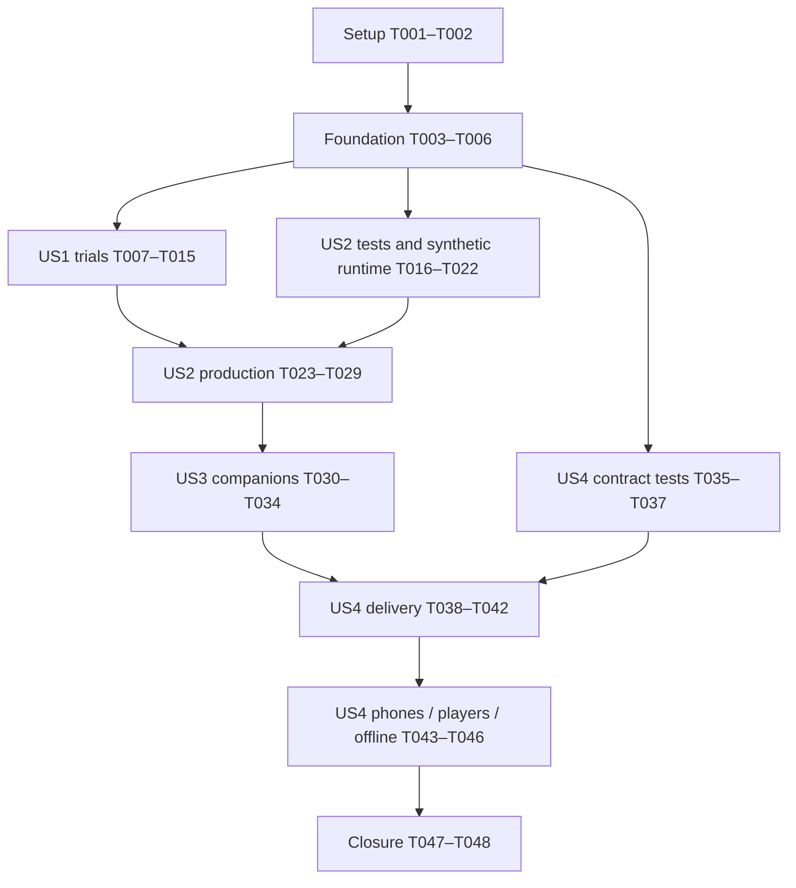

# Tasks: Expressive Fighter and Companion Animations

**Input**: [spec.md](spec.md), [plan.md](plan.md), [research.md](research.md), [data-model.md](data-model.md), [presentation contract](contracts/animation-presentation.md), [asset contract](contracts/animation-assets.md), [quickstart.md](quickstart.md).

**Branch**: `011-implement` — existing implementation branch for feature `011-improve-character-animations`; preserve unrelated changes.

**Tests**: TDD is mandatory. For each automatable change, write the specified test and observe its expected failure before implementation; then run the focused tests to green. Preserve passing existing regressions. Define manual checks before visual production. Documentation and source-inventory tasks receive consistency checks rather than artificial runtime tests.

**Format**: `- [ ] Tnnn [P] [USn] Description with paths`. `[P]` means independent work within the explicitly stated ready batch, after its prerequisites have completed. It does not authorize spawning agents. Paths are repository-relative; proposed files are created by the named task. FR/SC IDs refer to this feature; AC IDs refer to PRD 2.7. Checked tasks record verified implementation; pending owner/device acceptance is never implied.

**Efficiency**: Use focused tests during iteration and one complete release-candidate validation before device/player checks. Reuse unchanged evidence; rerun only affected checks after fixes, and the full suite before any commit. Shared files and catalogues have one writer. If a check fails, fix its owning task and invalidate affected downstream evidence; do not add parallel reports that repeat the same result.

## Phase 1: Setup

**Purpose**: Establish the baseline and review procedures using the existing project.

- [X] T001 Verify branch, pinned tools and existing baseline commands from `package.json`; record source/build hashes, current four-character motion captures and actual test results in `specs/011-improve-character-animations/validation/baseline.md`, preserving feature 010 fingerprints and unchanged simulation fixtures. (FR-005, FR-009; AC-068, AC-071)
- [X] T002 Define the action/facing/role matrix, matched source-comparison procedure, phone/offline and five-player recording fields in `specs/011-improve-character-animations/validation/strategy.md` by referencing `quickstart.md` sections A–G; identify unavailable reviewers/devices as dependencies without marking evidence passed. (FR-001–010; AC-066–071)

## Phase 2: Foundational contracts

**Purpose**: Validate profiles and asset invariants using small fixtures before any production changes.

**Prerequisites**: T001–T002. These four tasks block story implementation; they do not require a selected donor library or final production assets.

- [X] T003 [P] Write and observe failing schema tests in `tests/godot/content/test_hero_animation_catalog.gd` for exact semantic coverage, model-key authority, source summaries, four directional loops, ordered phase segments/contact markers, finite bounds and invalid/missing fields. Use synthetic profile records from the data model. (FR-003–005, FR-008; AC-067–068, AC-071)
- [X] T004 Implement pure profile validation in `game/content/hero_animation_catalog.gd` until T003 passes; leave live catalogue activation for T027 and keep `content/animation-clips.json` as semantic coverage authority. (FR-003–005, FR-008; AC-067–068, AC-071)
- [X] T005 [P] Write and observe failing source/export invariant tests in `tests/blender/test_hero_motion.py` using small synthetic rigs: valid weights, rigid plate/face attachments, wing groups, root travel exclusion, loop/phase boundaries, invalid tracks and donor geometry removal. (FR-002–004; AC-067–068)
- [X] T006 Implement the bounded validation/bake helpers in `scripts/blender/hero_motion.py` to pass T005, with declared numeric tolerances and isolated outputs; reuse existing Blender action-slot/export conventions rather than adding a general retargeting framework. (FR-002–004; AC-067–068)

**Checkpoint**: Synthetic contracts pass. T003/T005 may run together; T004 depends on T003 and T006 depends on T005. No production hero is replaced in this phase.

## Phase 3: US1 — Review animation candidates on actual characters (P1)

**Goal**: Eight source trials produce four matched current/KayKit/Universal comparisons and recorded source decisions.

**Independent test**: Review idle, travel and representative attack in both facings on each real character, with exact source/license evidence, adaptation limits and a source/custom recommendation. Full gameplay integration is not required.

### Tests first

- [X] T007 [P] [US1] Write and observe failing trial tests in `tests/blender/test_hero_trials.py` for exact source-file/clip selection, differing KayKit Medium/Large names, explicit bone mapping, reproducible isolated exports and preserved donor bytes. (FR-001–002, FR-010; AC-066)
- [X] T008 [P] [US1] Write and register failing review-fixture tests in `tests/godot/presentation/test_hero_review.gd` and `tests/e2e/hero-animation.spec.ts`; cover independent baseline/candidate sampling, matched camera/settings and Web Release exclusion in `tests/tooling/export.test.ts`, registering the browser filename in `playwright.godot.config.ts`. (FR-001, FR-010; AC-066)

### Implementation and review

- [X] T009 [US1] Inventory and retain the selected trial inputs/license hashes under `assets/art-sources/`, reusing the existing KayKit record in `content/art-provenance.json`; extend `scripts/blender/hero_motion.py` with explicit character/source/output selection and mapping/bake support to pass T007. Record unknown original acquisition dates separately from repository retention dates. (FR-001–002, FR-010; AC-066)
- [X] T010 [US1] Implement `tests/godot/fixtures/hero-animation/review.gd` and its test-only route via `game/platform/test_bridge.gd` and `scripts/godot/export.ts`; pass T008 with isolated trial clips and baseline views. Trial subsets must never weaken full production profile validation or enter Web Release. (FR-001, FR-010; AC-066)
- [X] T011 [P] [US1] Trial both libraries on Cow from `assets/characters/cow-crow/cow.blend`, saving isolated rig/mapping/GLB outputs in `tests/godot/fixtures/hero-animation/candidates/cow/` and results in `specs/011-improve-character-animations/reviews/cow-candidates.md`; compare weight shifts, articulation and silhouette. (FR-001–002, FR-010; AC-066)
- [X] T012 [P] [US1] Trial both libraries on Crow from `assets/characters/cow-crow/crow.blend`, saving isolated outputs in `tests/godot/fixtures/hero-animation/candidates/crow/` and results in `specs/011-improve-character-animations/reviews/crow-candidates.md`; preserve wing/feather anatomy and aviator jacket. (FR-001–002, FR-010; AC-066)
- [X] T013 [P] [US1] Trial both libraries on Lion from `assets/characters/lion/source.blend`, saving isolated outputs in `tests/godot/fixtures/hero-animation/candidates/lion/` and results in `specs/011-improve-character-animations/reviews/lion-candidates.md`; assess large-body articulation and slow/strong motion. (FR-001–002, FR-010; AC-066)
- [X] T014 [P] [US1] Trial both libraries on Plates from `assets/characters/plates/source.blend`, saving isolated outputs in `tests/godot/fixtures/hero-animation/candidates/plates/` and results in `specs/011-improve-character-animations/reviews/plates-candidates.md`; keep the entire plate and face rigid while articulating limbs. (FR-001–002, FR-010; AC-066)
- [X] T015 [US1] Assemble the four matched comparisons, record actual owner feedback and per-character/action source or custom-motion decisions in `specs/011-improve-character-animations/reviews/source-decisions.md`, and reconcile selected source records in `content/art-provenance.json`; retain rejected trials and unmet coverage explicitly. (FR-001, FR-010; SC-001; AC-066)

**Checkpoint / first increment**: Both libraries assessed for all four characters, comparisons reviewable, source decisions recorded. Full asset production depends on T015. If review is pending, keep it pending and continue only independent test/infrastructure work.

## Phase 4: US2 — Read and enjoy each fighter's existing actions (P1)

**Goal**: Full articulated fighter coverage with truthful timing, directional locomotion, reactions, previews and knockout.

**Prerequisites**: Foundation; T015 for production tasks T023–T026. Tests and synthetic runtime work can proceed while source review is pending.

**Independent test**: Exercise every fighter state in both facings, compare visible contact/release with authoritative phase windows, check unchanged simulation traces and inspect actual imported bones and final gameplay.

### Tests first

- [ ] T016 [P] [US2] Write and observe failing observer tests in `tests/godot/presentation/test_character_motion_state.gd` for every-step observation, multiple steps per render, duplicate renders, actual travel/depth movement, excluded knockback/Dodge/recovery travel, hit-event/HP deduplication and zero-HP priority. Assert run/event inputs remain unchanged. (FR-004–006; AC-067–069)
- [ ] T017 [P] [US2] Write and observe failing resolver tests in `tests/godot/presentation/test_character_pose.gd` for continuous phase anchors/action identity, directional loop samples, first-active-tick contact/release, capped blends, rest-relative masked reactions and knockout endpoint hold. (FR-003–006; AC-067–069)
- [ ] T018 [P] [US2] Add failing imported-bone/readiness/batching assertions in `tests/godot/presentation/test_import.gd`, `tests/godot/content/test_resource_store.gd` and `tests/godot/art/test_character_batches.gd`; add preview/results-clock tests in `tests/godot/app/test_hero_presentation.gd` for reduced motion, lifecycle freezes, explicit terminal Resume and immediate Retry with unchanged run time/state. (FR-003–008; AC-067–071)
- [ ] T019 [P] [US2] Replace only superseded seven-bone/direct-physical-clip assumptions in `tests/blender/test_rig_export.py` and the hero-freeze assertion in `tests/blender/test_enemy_exports.py` with failing articulated-attachment, semantic-binding and complete-export checks; preserve old fingerprint evidence and supplier/enemy/scenery immutability assertions. (FR-002–005; AC-067–068)

### Implementation and review

- [ ] T020 [US2] Implement private motion state and pure sampling in `game/presentation/character_motion_state.gd` and `game/presentation/character_pose.gd` to pass T016–T017; use actual per-tick distance, at most two directional samples, bounded reaction/transition state and simulation-owned action timing. (FR-003–006; AC-067–069)
- [ ] T021 [US2] Implement manual profile sampling and local-bone blending in `game/presentation/character_view.gd`; update `game/presentation/character_batches.gd` only as needed to exclude node-animated attachments and preserve independent skeletons/shared immutable resources. Pass relevant T018 imported-bone/batching tests. (FR-002–006; AC-067–069)
- [ ] T022 [US2] Implement independent preview clocks and bounded terminal knockout settling in `game/app/main.gd` and `game/app/run_session.gd`, passing T018 app tests with synthetic profiles: freeze on interruption/modal, Resume the terminal target without restarting gameplay/audio/time, and keep Retry/Home immediate. (FR-003, FR-006–007; AC-067, AC-069–070)
- [ ] T023 [P] [US2] Produce Cow's complete selected/custom motion in `assets/characters/cow-crow/runtime/cow-rigged.blend` and `assets/characters/cow-crow/runtime/cow.glb`; stage bindings in `specs/011-improve-character-animations/reviews/cow-bindings.json`, covering directional gait, all player/support semantics and one authored spin. Pass applicable T019 checks. (FR-002–005; AC-067–068)
- [ ] T024 [P] [US2] Produce Crow's complete selected/custom motion in `assets/characters/cow-crow/runtime/crow-rigged.blend` and `assets/characters/cow-crow/runtime/crow.glb`; stage bindings in `specs/011-improve-character-animations/reviews/crow-bindings.json`, covering directional gait, all semantics, attached wing groups and one wing spin. Pass applicable T019 checks. (FR-002–005; AC-067–068)
- [ ] T025 [P] [US2] Produce Lion's complete selected/custom motion in `assets/characters/lion/runtime/rigged.blend` and `assets/characters/lion/runtime/character.glb`; stage bindings in `specs/011-improve-character-animations/reviews/lion-bindings.json`, covering directional gait, all semantics and ROAR with correct release timing. Pass applicable T019 checks. (FR-002–005; AC-067–068)
- [ ] T026 [P] [US2] Produce Plates' complete selected/custom motion in `assets/characters/plates/runtime/rigged.blend` and `assets/characters/plates/runtime/character.glb`; stage bindings in `specs/011-improve-character-animations/reviews/plates-bindings.json`, covering directional gait, all semantics, rigid plate/face and the headrest launch gesture. Pass applicable T019 checks. (FR-002–005; AC-067–068)
- [ ] T027 [US2] Assemble the four validated records in `content/hero-animations.json`; load/freeze them through `game/content/catalogue.gd` and add profile-aware preparation in `game/content/resource_store.gd`, validating actual physical clips/segments and cached templates while retaining `content/resources.json` model-path authority. Pass T003/T018 readiness tests. (FR-003–005, FR-008; AC-067–068, AC-071)
- [ ] T028 [US2] Connect per-step observation before result handling in `game/app/main.gd` and profile poses in `game/presentation/world_view.gd`; remove superseded hero squash/tilt/extra spin, preserve existing scale/facing/envelopes and the simulation headrest prop. Extend `tests/e2e/hero-animation.spec.ts` with failing ordinary-gameplay assertions before integration, then verify all T016–T019 checks and unchanged parity fixtures pass. (FR-003–007; AC-067–070)
- [ ] T029 [US2] Run the full fighter matrix from quickstart B/D and record matched gameplay captures, contact-window checks and actual owner feedback in `specs/011-improve-character-animations/reviews/fighters.md`; resolve visible defects in their owning asset/runtime tasks and rerun affected checks before marking every fighter state accepted. (FR-002–007, FR-010; SC-002–003; AC-067–070)

**Checkpoint**: Four fighters have complete reviewed motion, preserved gameplay and correct previews/results. Asset tasks T023–T026 require T015, T019 and the tested authoring helpers; they write separate files and must not regenerate another character or the shared profile catalogue.

## Phase 5: US3 — See a lively, independent companion (P1)

**Goal**: Every companion moves, supports, reacts and becomes inactive independently across all twelve duos.

**Prerequisites**: T020–T028 and production support semantics. This story is independently evaluated with the completed fighter foundation; it is not claimed independent of shared rigs.

**Independent test**: Exercise all twelve ordered duos, real support damage ticks, pursuit/follow/catch-up, interruption, knockout/solo continuation and ten Home/retry cycles.

### Tests first

- [ ] T030 [P] [US3] Add failing companion assertions to `tests/godot/presentation/test_character_motion_state.gd` and `tests/godot/presentation/test_character_pose.gd`: support-ready anticipation, immediate `partner-hit` contact, six-tick active action, interruptible follow-through, actual pursuit/catch-up distance, obstruction reset and no player-only Special. (FR-003–006; AC-068–069)
- [ ] T031 [P] [US3] Write failing twelve-duo/preview isolation and teardown tests in `tests/godot/presentation/test_hero_partners.gd` and `tests/e2e/hero-companions.spec.ts`; register the latter in `playwright.godot.config.ts` and assert distinct actions/bones, knockout persistence, retained-duo retry and stable owned-resource counts. (FR-003, FR-006; AC-069)

### Implementation and review

- [ ] T032 [US3] Implement role-correct support presentation in `game/presentation/character_motion_state.gd`, `game/presentation/character_pose.gd` and `content/hero-animations.json` to pass T030; adapt support bindings/poses where necessary without adding AI windup, gameplay recovery, damage or abilities. (FR-003–005; AC-068–069)
- [ ] T033 [US3] Complete per-run/per-actor motion ownership and reset/disposal in `game/presentation/world_view.gd` and `game/presentation/character_view.gd` to pass T031, including simultaneous different actions, independent preview state, dead-companion hold and retry during settling. (FR-006; AC-069–070)
- [ ] T034 [US3] Execute quickstart C on all twelve ordered duos, confirm unchanged AI/solo-completion behavior and record actual full-role review in `specs/011-improve-character-animations/reviews/companions.md`; complete ten lifecycle cycles and link owner feedback for all four partners. (FR-003–006, FR-010; SC-002–003; AC-069)

**Checkpoint**: Each character passes as fighter and partner; all twelve duo combinations pass role/state/reset checks without altered support behavior.

## Phase 6: US4 — Keep mobile combat responsive and available offline (P1)

**Goal**: Deliver the complete animated game with reliable loading/cache/updates, source credits, usable mobile controls and measured phone performance.

**Prerequisites**: Final acceptance requires US2/US3. T035–T037 can be authored earlier against contract fixtures; shared-file edits are serialized.

**Independent test**: Build a complete release; exercise hero load failures, cache/updates and denied audio/storage, then complete actual phone play/offline/retry and five-player checks on the same build identity.

### Tests first

- [ ] T035 [P] [US4] Add failing hero source/credits/CLI/export tests in `tests/unit/art/hero-animation.test.ts` and `tests/tooling/export.test.ts`: accepted-source traversal, stale hashes/summaries, unknown dates, exact physical clip validation, fixture/source exclusion, single pack ownership and existing byte budgets. (FR-008–010; AC-071)
- [ ] T036 [P] [US4] Add failing hero integrity/lifecycle tests in `tests/godot/content/test_hero_readiness.gd` and `tests/godot/app/test_hero_presentation.gd` for missing scene/profile/clip, invalid tracks/segments, cached-template rechecks, stale preparation generation and retained-duo actionable Retry; retain freeze/explicit Resume and nonblocking audio/storage checks. (FR-006–008; AC-070–071)
- [ ] T037 [P] [US4] Write and register failing hero delivery journeys in `tests/e2e/hero-delivery.spec.ts` and release-exclusion assertions in `tests/e2e/godot-release.spec.ts`; cover all four characters in both roles, cached assets/credits, input cancellation, reduced-motion previews, load repair, truthful cache status and safe updates. Register the new file in `playwright.godot.config.ts`. (FR-007–010; AC-070–071)

### Implementation and acceptance

- [ ] T038 [US4] Reconcile selected/runtime hero records in `content/art-provenance.json` and source summaries in `content/hero-animations.json`; extend `scripts/art/validate.ts`, `game/tools/validate_art.gd` and `game/content/hero_animation_catalog.gd` with nonmutating `--character` and unfiltered hero validation to pass T035–T036. Validate real imported targets/weights/roots and preserve explicit incomplete status for definitions-only checks. (FR-002–005, FR-008, FR-010; AC-067–068, AC-071)
- [ ] T039 [US4] Extend hero source discovery and generated notices in `scripts/art/credits.ts`; update `scripts/art/delivery.ts` and `scripts/godot/export.ts` for profile/dependency closure, accurate report identity and strict source/review-fixture exclusion. Pass T035/T037 tooling/release checks using existing complete-cache and byte-budget mechanisms. (FR-008–010; AC-071)
- [ ] T040 [US4] Complete preview/locked-duo readiness errors, cached validation and generation isolation in `game/content/resource_store.gd`, `game/app/main.gd` and `game/app/readiness.gd` as applicable to pass T036; preserve existing runtime-versus-cache readiness and explicit lifecycle resume. (FR-006–008; AC-070–071)
- [ ] T041 [US4] Complete test-only diagnostic/fixture support in `game/platform/test_bridge.gd` as needed for T037, then run the registered Chromium/WebKit hero delivery journeys; record actual outcomes and emulation limitations in `specs/011-improve-character-animations/validation/browser.md`. Fixture-skipped encounters do not count as physical full-run evidence. (FR-007–010; AC-070–071)
- [ ] T042 [US4] Run `bun run typecheck`, `bun run test`, `bun run test:art`, `bun run validate:art`, release/diagnostics builds and the ordinary release audit; record commands, results, build identity, content/engine/cache/compressed bytes and baseline frame/resource metrics in `specs/011-improve-character-animations/validation/release.md`. This validated candidate supplies T043–T046; preserve the exact measured artifacts. (FR-005, FR-008–009; AC-068, AC-071)
- [ ] T043 [P] [US4] Validate a full run and busiest encounters on iPhone 12/Safari with intended soundtrack, touch cancellation, safe areas, mute/no-shake, reduced motion and lifecycle interruption; record OS/browser/build identity, frame pacing, stalls, thermal/sustained-play observations and 60 fps target/30 fps minimum results in `specs/011-improve-character-animations/validation/iphone-12.md`. (FR-006–007, FR-009; SC-004–005; AC-070–071)
- [ ] T044 [P] [US4] Perform the equivalent full-run performance, touch/readability and lifecycle checks on Pixel 6/Chrome; record actual device/build metrics in `specs/011-improve-character-animations/validation/pixel-6.md`, preserving all encounters and inherited render/content budgets. (FR-006–007, FR-009; SC-004–005; AC-070–071)
- [ ] T045 [P] [US4] Conduct the counterbalanced five-player comparison and action-recognition/readability/responsiveness evaluation from quickstart G; record separate per-player judgments and PRD SC-010 style outcomes in `specs/011-improve-character-animations/validation/playtest.md`. Require each SC-004 threshold rather than averaging distinct outcomes. (FR-007, FR-010; SC-004; PRD SC-004, SC-010, SC-014)
- [ ] T046 [US4] Verify cold cached offline launch through complete play/results/retry on both phones, collectively covering every character in both roles; exercise credits, failed caching/loading, audio/storage denial and waiting updates with secure-origin browser/PWA setup, recording results in `specs/011-improve-character-animations/validation/offline-reliability.md`. (FR-008; SC-006; AC-071)

**Checkpoint**: Phone, offline and participant evidence meets the spec on the recorded release. Missing devices/reviews remain pending. Any relevant code/asset change invalidates affected captures/performance/source hashes: fix the owning task, rebuild and repeat affected acceptance; retain unchanged checks without unnecessary reruns.

## Phase 7: Polish and cross-cutting closure

- [ ] T047 Reconcile all FR/SC/PRD acceptance links and current build/source hashes in `specs/011-improve-character-animations/validation/acceptance.json` and `specs/011-improve-character-animations/validation/acceptance.md`; use the existing audit schema, retain pending/failing evidence truthfully and update `quickstart.md` only where implemented commands differ. Fix measured defects through their owning tasks, not a separate unscoped cleanup. (FR-001–010; SC-001–006; AC-066–071)
- [ ] T048 Run the final build-bound evidence audit with `scripts/audit-build.ts`, validate documentation/diff consistency and report completion in `specs/011-improve-character-animations/validation/acceptance.md`; reuse T042 automation only for unchanged inputs, otherwise rerun affected checks and all tests before any conventional commit. Preserve unrelated edits, inspect for secrets and do not reuse old-feature waivers or deploy automatically. (FR-001–010; SC-001–006; Constitution delivery gates)

## Dependencies and execution order

### Task prerequisites and file ownership

- Default execution is phase order and ascending IDs, except the explicit ready batches below. A `[P]` task may start only after its dependencies have passed; never run a test and its implementation simultaneously.
- T003 and T005 depend on setup, not on each other; T004 requires T003's expected failure, T006 requires T005's. Both implementations must pass before US1 trials.
- T007/T008 are independent red tests after foundation. T009 requires T007; T010 requires T008/T009. T011–T014 require T009/T010 and use isolated character outputs; T015 follows all four.
- T016–T019 are independent red tests after foundation. T020 requires T016/T017; T021 and T022 require T018 plus the tested core. The scoped exporter in `scripts/blender/hero_motion.py` / `scripts/blender/rig_export.py` must support the selected rigs before production; extend it test-first under T019 and the owning character task, serializing shared helper edits.
- T023–T026 require T015 and T019; perform any shared helper changes first, then isolate per-character export work. T027 serially merges all bindings/provenance summaries; T028 follows T020–T027; T029 follows integrated runtime.
- T030/T031 follow the fighter foundation and write different tests. T032 follows T030; T033 follows T031/T032; T034 verifies the integrated twelve-duo result.
- T035–T037 can be drafted against fixtures after foundation; they must not overlap earlier writers of the same test/config files. T038–T041 follow their failing tests and completed actor integration. Keep single writers for `content/hero-animations.json`, `content/art-provenance.json`, `game/app/main.gd`, `scripts/godot/export.ts` and `playwright.godot.config.ts`.
- T042 validates the complete candidate before T043–T046. T043/T044/T045 use independent devices/participants and distinct records, with the same immutable build; T046 follows device setup. T047–T048 require all acceptance outcomes or explicitly report an incomplete feature, never a fabricated pass.

## Parallel examples by story

| Story | Ready batch | Prerequisites / conflict boundary |
| --- | --- | --- |
| US1 | T007 + T008; later T011 + T012 + T013 + T014 | Foundation, then shared trial tooling/fixture. Character outputs stay isolated; T015 alone updates source decisions. |
| US2 | T016 + T017 + T018 + T019; later T023 + T024 + T025 + T026 | Foundation, then source decisions and failing export checks. Serialize shared exporter changes and T027 catalogue merge. |
| US3 | T030 + T031 | Completed fighter core; separate test files. Shared observer/view implementations remain sequential. |
| US4 | T035 + T036 + T037; later T043 + T044 + T045 | Contract fixture/test writers free, then T042 immutable candidate. Do not share a modified build or evidence file. |

Parallel opportunities describe work scheduling, not a requirement to delegate. Run sequentially when that is cheaper or when tools/assets share mutable state.

## Coverage map

| Requirement | Principal tasks | Acceptance |
| --- | --- | --- |
| FR-001 | T007–T015 | US1.1–1.4; SC-001; AC-066 |
| FR-002 | T005–T006, T011–T014, T019, T023–T029 | US1.3, US2.1; SC-002; AC-067 |
| FR-003 | T003–T004, T016–T034 | US2/US3 all states; SC-002; AC-067, AC-069 |
| FR-004 | T005–T006, T017, T019–T029 | US2.1–2.4; SC-002–004; AC-067–068 |
| FR-005 | T016–T021, T027–T034, T042 | US2.3–2.5, US3.2–3.3; SC-003; AC-068 |
| FR-006 | T016, T018, T020–T022, T028, T030–T034, T036, T040–T044 | US2.5, US3.1/3.4, US4.2; SC-002–003; AC-069–070 |
| FR-007 | T018, T022, T029, T037, T041–T045 | US4.1–4.2; SC-004; AC-070 |
| FR-008 | T027, T035–T042, T046 | US4.3; SC-006; AC-071 |
| FR-009 | T042–T044 | US4.4; SC-005; AC-071 |
| FR-010 | T009, T015, T029, T034–T039, T043–T048 | US1/US2/US3/US4 reviews; SC-001–006; AC-066, AC-071 |

## Implementation strategy

The first useful increment is **US1 after setup/foundation**: actual-character source comparisons and recorded choices. It is a reviewable exploration milestone, not a claim of finished gameplay or full MVP acceptance.

Next deliver US2's complete fighter slice, then US3's companion coverage, then US4's complete mobile/offline release evidence. Shared runtime tests can advance during source review without committing to unreviewed final assets. All four stories are P1 and required for this feature; incremental delivery does not make later stories optional.

Use one evidence record per outcome, linking captures/logs rather than repeating them. Keep tasks unchecked until their actual outcome is verified; owner/device dependencies can be reported while independent work continues. No before/after task hooks are configured. Task generation changes documentation only; executing these tasks belongs to the implementation workflow.
